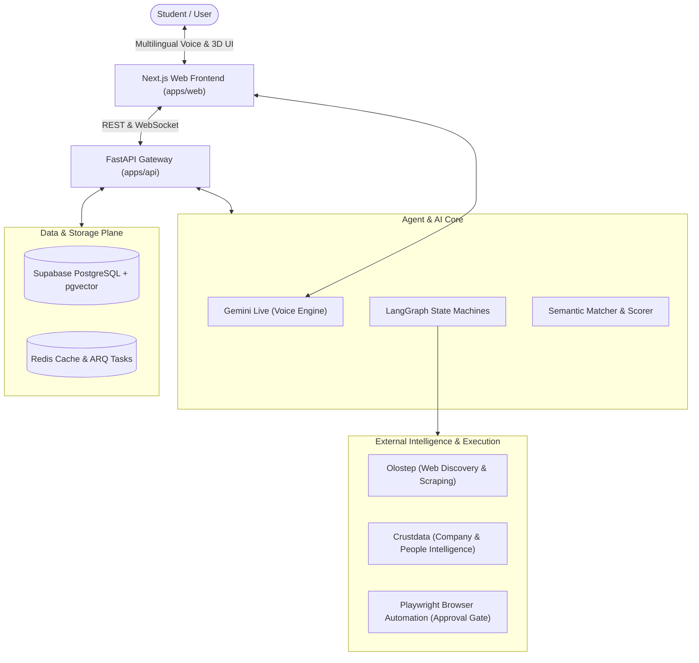

# NexteRaS (`opportunity-os`)

> **The Upcoming Era. — AI Career Intelligence & Autonomous Employability System for Indian Students**  
> *Developed by Team SyNtRax (Sanju, Sanjeeth S, Ramaraju R, Nikhil N).*

---

## 🎯 Executive Summary

**NexteRaS** (*The Upcoming Era*) bridges the digital divide for millions of Indian undergraduate and postgraduate students seeking internships, entry-level jobs, research fellowships, and government career schemes. 

Unlike traditional static job boards or ungrounded generative chatbots, NexteRaS is a **voice-first agentic employability system**. It understands vernacular queries across **7 Indian languages** (Hindi, Telugu, Tamil, Kannada, Malayalam, Bengali, and English), parses complex eligibility criteria deterministically, conducts semantic talent-to-opportunity matching using vector embeddings, builds ATS-optimized resumes with source grounding, and automates repetitive portal workflows under strict **human-in-the-loop approval gates**.

---

## 🏛 System Architecture Overview



---

## 🚀 Key Differentiators

1. **Multilingual Voice-First Experience:** Native spoken-language comprehension across 7 major Indian languages with real-time code-switching handling (e.g., Hinglish, Telugish).
2. **Deterministic + Probabilistic Eligibility Engine:** Hard qualification verification (branch, graduation year, CGPA, state quotas) combined with soft skill-gap analysis.
3. **Living Career Passport & Grounded Resume Builder:** Single source of verified student achievements generating customized, fact-checked resumes tailored per job description without hallucinations.
4. **Agentic Workflows with Human-in-the-Loop:** Automated job discovery, application preparation, and portal form-filling via Playwright with mandatory human verification before external submission.
5. **Real-Time Market Intelligence:** Integrated live scraping via **Olostep** and deep firmographic/recruiter intelligence via **Crustdata**.

---

## 📂 Monorepo Organization

```text
opportunity-os/
├── .github/          # CI/CD workflows, templates & CODEOWNERS
├── apps/
│   ├── web/          # Next.js 15+ App Router, Tailwind, Three.js, Voice UI
│   └── api/          # FastAPI backend, LangGraph agents, PyTorch/ML, Playwright
├── packages/
│   ├── shared-types/ # Common TypeScript types & interfaces
│   ├── api-client/   # Typed HTTP & WebSocket client
│   ├── design-tokens/# CSS variables & theme tokens
│   └── shared-config/# Shared ESLint, Prettier, TypeScript configs
├── supabase/         # PostgreSQL schema, pgvector migrations & seeds
├── infra/            # Docker, deployment & monitoring configurations
├── scripts/          # Developer setup, verification & seed automation
├── docs/             # Complete 13 Architecture Blueprints & ADRs
└── experiments/      # Jupyter notebooks & ML exploration
```

---

## ⚡ Quickstart

### Prerequisites
- Node.js `v20.0.0+` & `pnpm v9.0.0+`
- Python `3.12+` or `3.13+` & `uv` package manager
- Docker Desktop (optional for local PostgreSQL + Redis)
- Git & GitHub CLI (`gh`)

### Local Setup in 3 Commands

```bash
# 1. Clone repository
git clone https://github.com/sanjuskb/opportunity-os.git
cd opportunity-os

# 2. Copy environment template
cp .env.example .env

# 3. Install all dependencies
make install
# or:
pnpm install
cd apps/api && uv sync
```

### Running the Development Environment

```bash
# Start frontend (http://localhost:3000)
pnpm --filter @opportunity-os/web dev

# Start backend (http://localhost:8000)
cd apps/api && uv run uvicorn app.main:app --reload
```

---

## 👥 Engineering Team & Ownership

| Developer | Core Ownership | Personal Branch |
| :--- | :--- | :--- |
| **Sanju** | Frontend Lead, UX Architecture, Three.js/Motion, Voice Client, Career Passport UI, **All ML Model Selection, Training Experiments & Evaluation** | `sanju` |
| **Ramaraju** | Backend Lead, FastAPI, Database & Migrations, LangGraph State Machines, Olostep/Crustdata Integrations, Browser Automation | `ramaraju` |
| **Shared** | Cross-Team Contracts, End-to-End Integration, Security & Deployment Coordination | `develop` / `main` |
| **Antigravity** | Continuous Architecture QA, Test Planning & Repository Health | `antigravity/*` |

See [Team Responsibilities](docs/team/team-responsibilities.md) and [Contributing Guide](CONTRIBUTING.md) for full details.

---

## 📄 License
Licensed under the [Apache License, Version 2.0](LICENSE).
