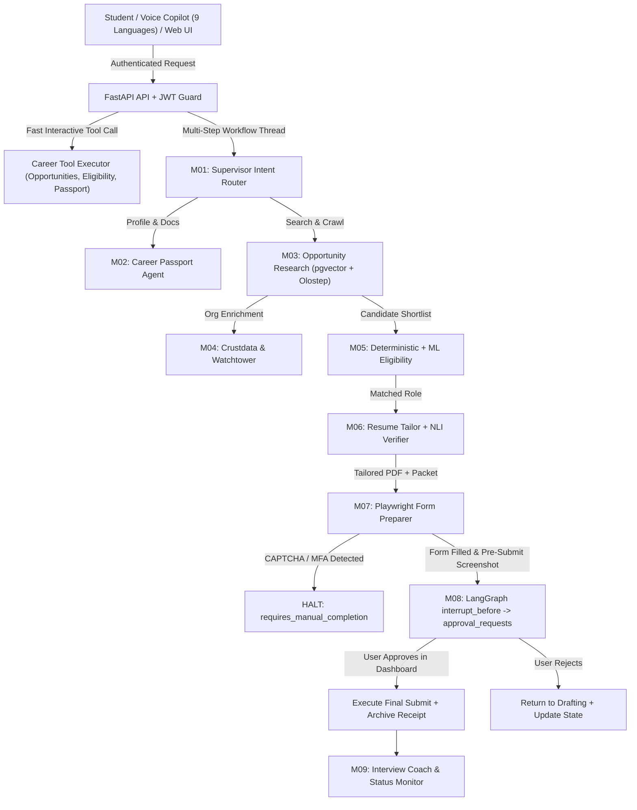
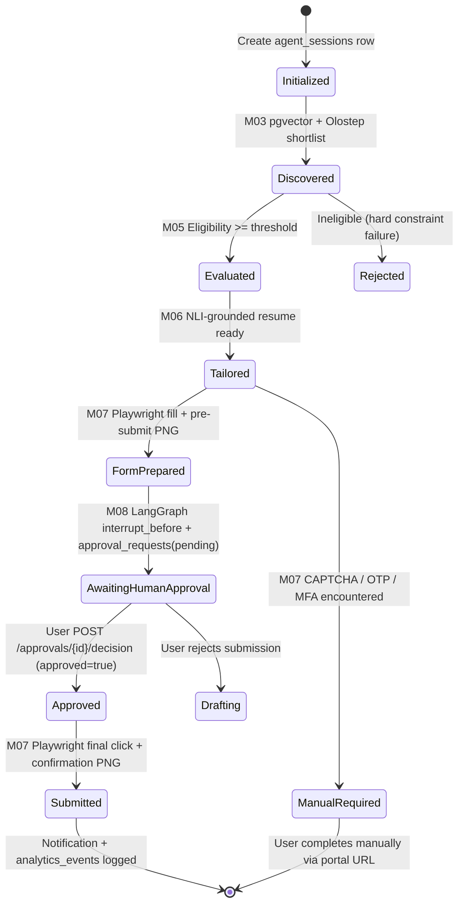
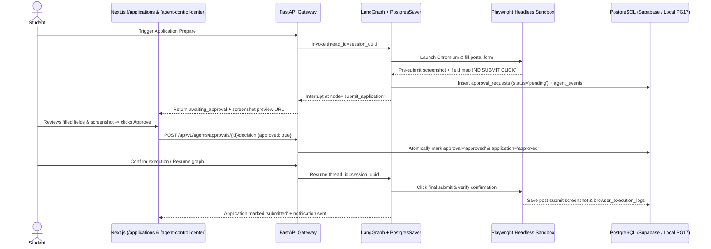
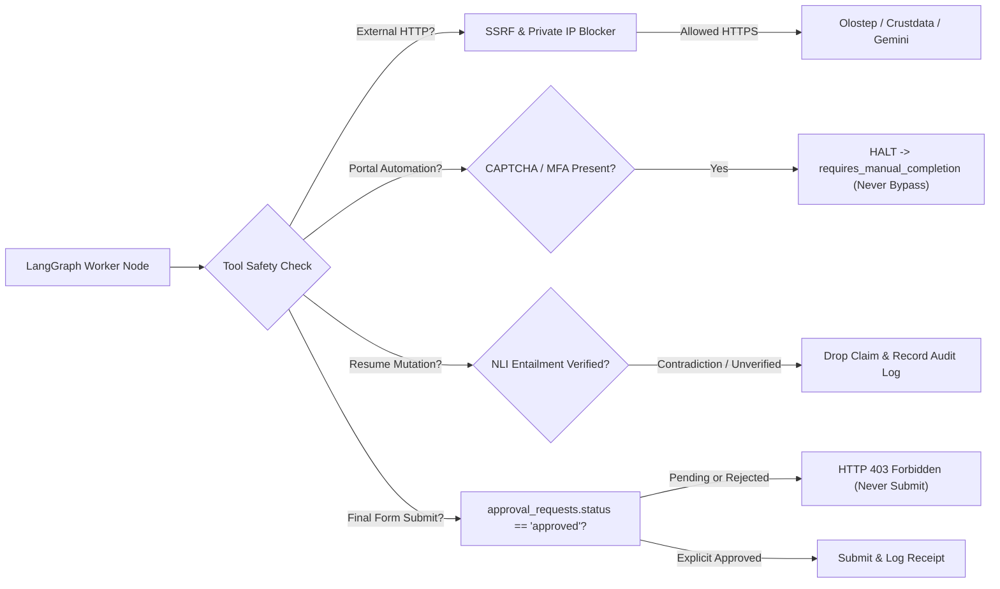

# NexteRaS (Opportunity OS) — Autonomous Agent Architecture Proposal

> [!NOTE]
> **Implementation Status (`feat/ws8-autonomous-agents` — Approved & Implemented):** Following explicit owner approval and PR #13 merging into `develop` (`d7ccac9`), the autonomous 9-logical-agent LangGraph orchestrator ([`orchestrator.py`](file:///d:/ai%20career%20intelligence%20autonomous%20system/apps/api/app/agents/orchestrator.py)), `AsyncPostgresSaver` checkpointing (`langgraph-checkpoint-postgres==3.2.1`), M11 `interrupt()` / `Command(resume=...)` human approval gate, SSE telemetry (`GET /api/v1/agents/sessions/{id}/stream`), owned screenshot endpoint (`GET /api/v1/browser-logs/{id}/screenshot`), and Agent Control / Student UI wiring are **implemented and verified**.

---

## 1. Executive Summary & Design Philosophy

NexteRaS serves first-year through final-year Indian college students across 9 languages (`en`, `hi`, `te`, `ta`, `kn`, `ml`, `bn`, `mr`, `gu`) + Hinglish. The autonomous tier orchestrates long-running research, eligibility verification, NLI-grounded resume tailoring, and portal preparation **under strict determinism and mandatory human-in-the-loop safety gates**.

Rather than deploying 9 disconnected chat wrappers with redundant LLM round-trips and fragile prompt handoffs, this architecture organizes the **9 logical agent capabilities** into a hierarchical **LangGraph Super-Graph** backed by **PostgreSQL `PostgresSaver` checkpointing** (`public.agent_sessions`, `public.agent_events`, `public.approval_requests`, `public.browser_execution_logs`):

1. **Supervisor Intent & Multilingual Router (`M01`)** — Classifies intent/language, loads student state, dispatches bounded subgraphs, and merges responses back into the user's preferred language.
2. **Intake & Career Passport Agent (`M02`)** — Extracts structured academic/project evidence from voice interviews and uploaded documents without fabricating credentials.
3. **Opportunity Discovery & Research Agent (`M03`)** — Coordinates hybrid `pgvector` (`embedding_minilm_384` HNSW) recall + Olostep web discovery (`searches`, `scrapes`, `answers`, `crawls`).
4. **Company Intelligence & Watchtower Agent (`M04`)** — Enriches hiring organizations via Crustdata (`24h` DB cache) and schedules portal change monitors (`opportunity_monitors`).
5. **Eligibility & Skill-Gap Reasoning Agent (`M05`)** — Combines deterministic SQL/Python eligibility rules (`cgpa`, `batch`, `degree`, `backlogs`, `deadline`) with semantic fit and actionable skill-gap learning paths.
6. **Resume Intelligence & NLI Grounding Agent (`M06`)** — Parses PDF/DOCX artifacts, scores ATS alignment, tailors role-specific variants, and rejects unsupported claims via NLI entailment verification.
7. **Application Strategy & Playwright Preparation Agent (`M07`)** — Discovers form DOM fields via headless Chromium, auto-fills student data, captures pre-submit screenshots, and **halts cleanly at `interrupt_before=["submit_application"]`**. Also halts unconditionally on CAPTCHA/MFA (`requires_manual_completion`).
8. **Human-in-the-Loop Approval Gate Agent (`M08`)** — Persists `public.approval_requests`, pushes notification alerts, suspends graph thread via `PostgresSaver`, and resumes **only** after explicit authenticated user approval.
9. **Interview Prep & Post-Submission Monitor Agent (`M09`)** — Conducts 9-language technical mock interviews and tracks submission confirmations, deadline reminders, and application outcomes.

### Consolidated Execution Topology vs. Naive 9-Agent Mesh

To eliminate excessive LLM latency on latency-sensitive flows (e.g., sub-second Gemini Live voice turns), synchronous tool calls execute directly via FastAPI services (`execute_career_tool`), while **LangGraph Stateful Workflows** handle multi-step asynchronous pipelines via 4 coordinated worker clusters inside one checkpointed graph.

---

## 2. System Orchestration Architecture

---

## 3. Agent State Transitions & Checkpointing Lifecycle

---

## 4. Human-in-the-Loop Interrupt & Resume Sequence

---

## 5. Grounded Tool Execution & Safety Guardrails

---

## 6. Readiness Prerequisites Already Implemented

- **PostgreSQL Schema & RLS (`20261123000001` – `20261127000004`):** `agent_sessions`, `agent_events`, `approval_requests`, `browser_execution_logs`, `conversations`, `conversation_messages`, `voice_sessions`, `resumes`, `resume_versions`, `resume_customizations`, `student_embeddings`, `organizations`.
- **Typed Agent Contracts (`apps/api/app/agents/contracts.py`):** `AgentStateEnvelope`, `AgentCheckpointConfig` (`PostgresSaver` URI helper + `interrupt_before_nodes=["submit_application"]`), and read-only session/event telemetry logging.
- **Human-in-the-Loop Gate (`apps/api/app/services/approvals.py` & `apps/api/app/automation/playwright_runner.py`):** Verified end-to-end with live Chromium against a local portal fixture (`test_playwright_sandbox_prepare_halt_captcha_and_approved_submit_live`), proving unapproved execution returns HTTP 403 and CAPTCHA detection halts cleanly without bypass.

---

## 7. Approval Checklist & Implementation Status (`WS8 Complete`)

- [x] Consolidated 9-logical-agent LangGraph topology implemented (`apps/api/app/agents/orchestrator.py`).
- [x] Default cost caps, SSRF protections, and Redis-backed rate limits enforced for Olostep, Crustdata, and Gemini 3 Flash calls inside autonomous workflows.
- [x] Playwright Chromium sandbox gate + CAPTCHA/MFA safety halt + approval `HTTP 403` pre-submit enforcement implemented and verified.
- [x] Explicit owner sign-off received -> autonomous LangGraph orchestration, `AsyncPostgresSaver`, M11 `interrupt()`/`Command(resume=...)`, SSE telemetry, and live UI triggers built and verified (`test_agents_ws8_orchestrator.py`, `test_api_contracts.py`, `api-client.test.ts`).
