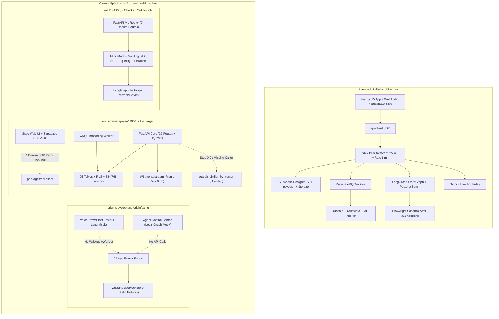
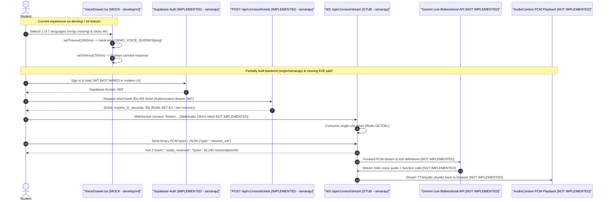
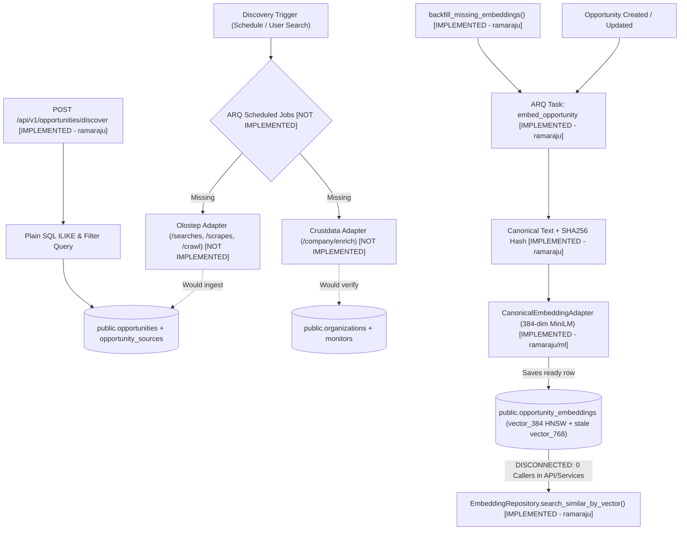
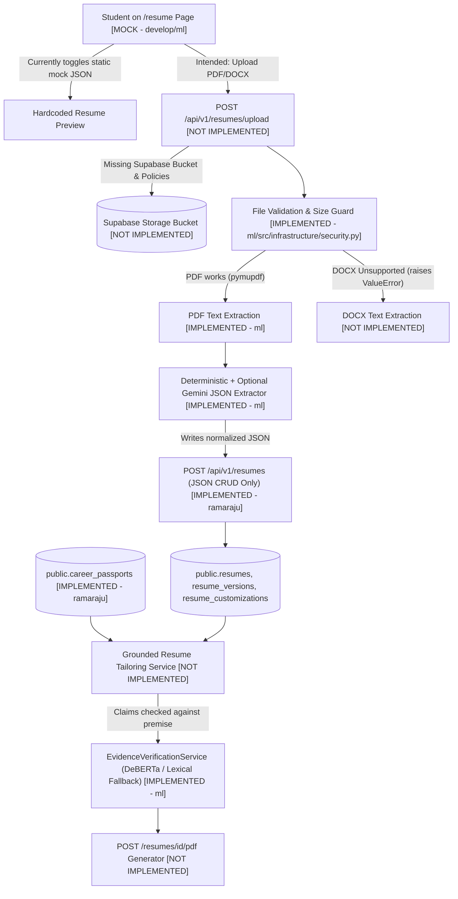
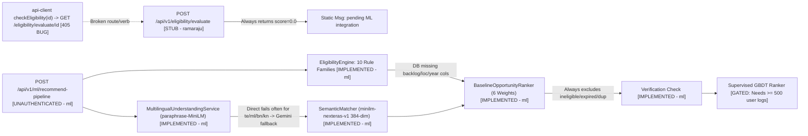
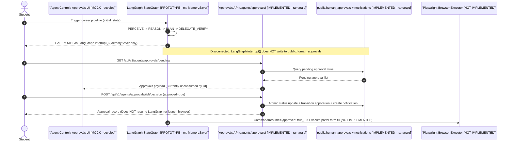
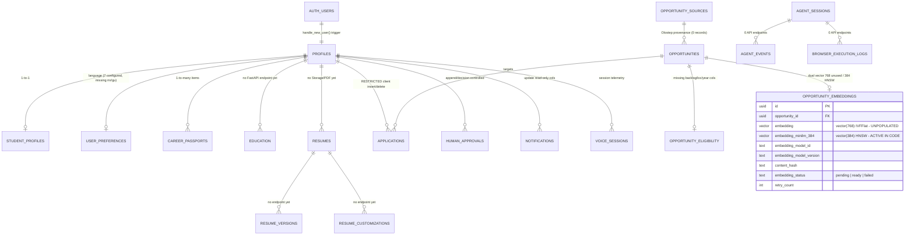
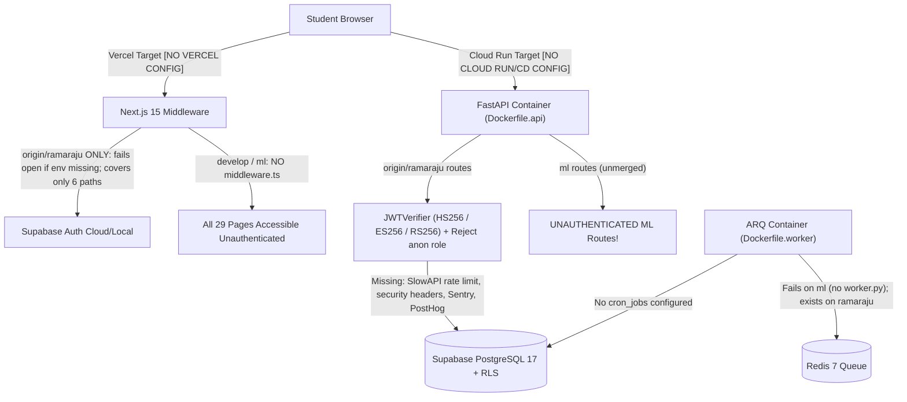

# NexteRaS (Opportunity OS) — Architecture & Data Flow Audit

**Updated:** 2026-11-26 (`feat/phase0-1-core-infra` post-consolidation build)  
**Pre-Consolidation Audit Baseline:** `origin/main`, `origin/develop`, `origin/sanju`, `origin/ml`, and `origin/ramaraju`

---

## Post-Consolidation Architecture Reconciliation (`feat/phase0-1-core-infra`)

After merging PRs `#10`–`#12` into `develop` and building Phases 0–9 on `feat/phase0-1-core-infra`, the fragmented three-branch reality documented below has been unified into the single integrated target system:
* **Frontend + Auth + i18n:** Next.js 15 (`29` pages / `33` build routes) uses `@tanstack/react-query` hooks ([`useOpportunityOs.ts`](file:///d:/ai%20career%20intelligence%20autonomous%20system/apps/web/src/lib/queries/useOpportunityOs.ts)) over `@opportunity-os/api-client`, fail-closed SSR [`middleware.ts`](file:///d:/ai%20career%20intelligence%20autonomous%20system/apps/web/src/middleware.ts), typed 9-language catalog [`messages.ts`](file:///d:/ai%20career%20intelligence%20autonomous%20system/apps/web/src/lib/i18n/messages.ts), and `AudioStreamingService` (`audioStreamer.ts`).
* **Unified FastAPI + Intelligence Layer:** Single gateway ([`main.py`](file:///d:/ai%20career%20intelligence%20autonomous%20system/apps/api/app/main.py)) exposing 78 OpenAPI HTTP operations + `WS /api/v1/voice/stream`, JWT-guarded `/ml/*`, Redis rate limiting, OWASP security headers, Sentry/PostHog (`observability.py`), `OlostepClient`, `CrustdataClient`, `GeminiClient` + `GeminiLiveRelay`, and Student/Company/University RBAC.
* **Postgres 17 + pgvector + Storage:** `29` `public` tables across `10` ordered SQL migrations, `student_embeddings` + `opportunity_embeddings` (`embedding_minilm_384` HNSW), private `resumes` Storage bucket + RLS, and live `search_similar_by_vector()`.
* **Background Workers & Safe Browser Sandbox:** ARQ `WorkerSettings` (`7` tasks, `3` crons) + Playwright Chromium `playwright_runner.py` with mandatory pre-submit screenshot pause (`approval_requests` `403` guard) and CAPTCHA/MFA halt.
* **Autonomous Agent Gate:** Typed `PostgresSaver` contracts ([`contracts.py`](file:///d:/ai%20career%20intelligence%20autonomous%20system/apps/api/app/agents/contracts.py)) & read-only session telemetry are live; full autonomous orchestration (`orchestrator.py`) is designed in [`NEXTERAS_AGENT_ARCHITECTURE_PROPOSAL.md`](file:///d:/ai%20career%20intelligence%20autonomous%20system/docs/NEXTERAS_AGENT_ARCHITECTURE_PROPOSAL.md) and **paused awaiting explicit approval**.

---

## Historical Pre-Consolidation Forensic Baseline (Preserved Below)

**Legend:**
- `[IMPLEMENTED - ml]` — Exists on `ml` / `origin/ml` branch.
- `[IMPLEMENTED - ramaraju]` — Exists on `origin/ramaraju` branch (unmerged).
- `[IMPLEMENTED - develop]` — Exists on `origin/develop` / `origin/sanju` / `ml` frontend.
- `[STUB]` / `[MOCK]` — Hardcoded, simulated, or placeholder response.
- `[PROTOTYPE]` — Compiled/tested in memory only; not DB-backed or wired into API runtime.
- `[NOT IMPLEMENTED]` — Absent across all branches.
- `[DISCONNECTED]` — Implemented in isolation but lacking caller or upstream/downstream wiring.

---

## 1. Intended vs. Current System Architecture Comparison

NexteRaS is designed as a cohesive, voice-first, multilingual (9 Indian languages required: `en, hi, te, ta, bn, mr, gu, kn, ml`; only 7 + `hinglish` configured) autonomous career operating system. In reality, **no single branch runs the complete architecture today**: frontend innovation lives on `origin/develop` and `ml`, ML/LangGraph prototypes live on `ml`, and DB/Auth/ARQ/FastAPI core services live on unmerged `origin/ramaraju`.

| Architecture Layer | Intended Technology | Current Implemented State | Verification Status | Branch(es) |
| :--- | :--- | :--- | :--- | :--- |
| **Frontend App** | Next.js 15, React 19, TypeScript, Tailwind | 29 App Router pages on `develop`/`ml` driven strictly by Zustand `useMockStore`; stale subset (10 routes deleted/reverted) + `@supabase/ssr` Auth UI added on `origin/ramaraju` | `next lint`, `tsc --noEmit`, `9/9` JS unit tests pass on `ml`; `next build` & live API integration unverified across merged branches | `ml` / `origin/develop` vs `origin/ramaraju` |
| **3D & Motion** | Spline, R3F / Three.js, Motion / GSAP | Custom Three.js `EcosystemScene` (`R3F`) + external Spline iframe (`GenkubRobot.tsx`) + CSS `ScrollReveal`; zero Framer Motion / GSAP packages installed | Renders in static tests (`landing-hero.test.js`); zero live WebGL/browser performance audit executed | `origin/develop` / `ml` |
| **i18n / Localization** | 9 Indic languages (`next-intl`, Noto fonts) | Only 7 languages configured (`en, hi, te, ta, kn, ml, bn` in `APP_CONFIG`); zero `next-intl` package or message catalogs; Marathi (`mr`) & Gujarati (`gu`) absent everywhere | Config contract checked; UI copy is English-only outside hardcoded `VoiceDrawer` demo phrases | All branches (gap) |
| **Backend API** | FastAPI + Pydantic v2 | Diverged into two incompatible routers: 22 DB/JWT/WS/stub routes on `origin/ramaraju` vs 7 stateless ML routes on `ml` | Unit-tested with fake repos/Redis on `origin/ramaraju` (not executed live in this env); 3 ML routes tested on `ml` (`test_ml_routes.py`) | Split: `origin/ramaraju` & `ml` |
| **Database & Vectors** | Supabase PostgreSQL 17 + `pgvector` | 25 tables, strict RLS (`20261126000001`/`000003`), dual vector columns (`vector(768)` + `vector(384)` HNSW), pipeline state (`20261126000004`) | Static SQL migration regex tests exist; **0 live Postgres migrations applied or queried** (`Docker` offline, `supabase status` failed on `ml`) | `origin/ramaraju` (+ `20261125000001` on `ml`) |
| **Auth & Storage** | Supabase Auth (JWT) + Supabase Storage | PyJWT HS256/ES256/RS256 verifier + `@supabase/ssr` middleware on `origin/ramaraju`; **zero storage buckets or storage policies defined** | JWT verifier unit-tested with mocked JWKS; E2E Supabase signup/login & Storage upload **NOT VERIFIED** | `origin/ramaraju` |
| **Primary LLM & Voice** | Gemini + Gemini Live WebSocket API | Text-only Gemini REST adapters (`httpx`) on `ml`; WS ticket store + PCM ack loop on `origin/ramaraju`; **no Gemini Live relay, no WebAudio client** | Unit/mock tests only (`GEMINI_API_KEY` missing); live Gemini API unverified | Split / `[NOT IMPLEMENTED]` |
| **ML Pipeline** | PyTorch, HF Sentence Transformers, scikit-learn | Fine-tuned `minilm-nexteras-v1` (384-dim), `paraphrase-multilingual-MiniLM-L12-v2`, `nli-deberta-v3-small`, deterministic eligibility/extractor/ranker | Offline unit tests + synthetic benchmarks executed; live latency/accuracy on real student data unverified; LightGBM ranker gated (`<500` rows) | `ml` |
| **Web / Company Intel** | Olostep + Crustdata | **0 HTTP clients, 0 schemas, 0 worker jobs** (`apps/api/app/integrations/__init__.py` is empty comment across all branches) | `[NOT IMPLEMENTED]` | None |
| **Agent Orchestration** | LangGraph + PostgreSQL checkpointer | Cyclic graph `build_nexteras_career_workflow` with `MemorySaver` + M11 `interrupt()` in `ml/src/integration/` (`apps/api/app/agents/` is empty) | `[PROTOTYPE]` (in-memory only; no `PostgresSaver`, no API trigger) | `ml` |
| **Browser Automation** | Playwright | `playwright` listed only as optional `automation` dependency extra in `apps/api/pyproject.toml`; 0 automation runners | `[NOT IMPLEMENTED]` | None |
| **Background Workers** | Redis + ARQ | ARQ worker (`app/tasks/worker.py`) + `embed_opportunity` / `backfill_missing_embeddings` on `origin/ramaraju`; absent on `ml` | Unit-tested with `_FakeRedis` / `_FakeRepo`; Redis offline locally | `origin/ramaraju` |
| **Deploy & Observability** | Vercel, Cloud Run, Sentry, PostHog | 4 Dockerfiles + Compose on `ramaraju`; **zero Vercel/Cloud Run manifests, zero Sentry SDK, zero PostHog SDK, zero rate limiting** | `[NOT IMPLEMENTED]` (infra code incomplete) | Partial Docker only |

---

## 2. Diagram 1 — Current Branch-Fragmented Reality vs. Target Architecture

---

## 3. Diagram 2 — Voice Interaction & Gemini Live Bidirectional Streaming Flow

Shows the exact divide between UI simulation (`VoiceDrawer.tsx`), unmerged ticket/WS plumbing (`origin/ramaraju`), and missing Gemini Live integration.

---

## 4. Diagram 3 — Opportunity Discovery, Company Enrichment & Vector Indexing Flow

Shows why `POST /api/v1/opportunities/discover` currently performs plain `ILIKE` SQL queries and never invokes external providers or vector similarity search.

---

## 5. Diagram 4 — Resume Upload, Storage, Grounded Extraction & Tailoring Flow

Compares the currently separated pieces: mock frontend (`/resume`), JSON-only REST backend (`origin/ramaraju`), stateless extraction/NLI ML services (`ml`), and missing Storage/DOCX/PDF-export layers.

---

## 6. Diagram 5 — Hybrid Eligibility, Semantic Matching, Ranking & Explainability Pipeline

Illustrates the sharp contract mismatch between `origin/ramaraju` (stubbed endpoint + SQL schema without full fields), `ml` (full stateless ML pipeline), and `@opportunity-os/api-client`.

---

## 7. Diagram 6 — LangGraph Orchestration & Human-in-the-Loop Approval Gate

Shows the end-to-end safety workflow where `ml` holds an in-memory LangGraph prototype (`MemorySaver`), `origin/ramaraju` holds DB approval persistence, and Playwright execution does not yet exist.

---

## 8. Diagram 7 — Supabase Database, Dual Vector Dimensions & RLS Topology

Documents the 25 tables, security remediation policies (`20261126000001` & `000003`), dual vector columns (`vector(768)` unused vs `vector(384)` HNSW active in code), and unimplemented schemas.

---

## 9. Diagram 8 — Authentication, Security Boundaries & Production Deployment Topology

Highlights auth split-brain (`@supabase/ssr` on stale `origin/ramaraju` UI vs unauthenticated UI/ML routes on `ml`/`develop`) and missing production infrastructure.

