# NexteRaS (Opportunity OS) — Sequenced Production Roadmap

**Updated:** 2026-11-26 (`feat/phase0-1-core-infra` post-consolidation build)  
**Target:** Single Principal/Full-Stack Engineer Execution Plan -> Executed Through Phase 9

> **Execution Status Update:** Following consolidation PRs `#10`, `#11`, and `#12` into `develop`, **Phases 0–8 deterministic engineering & Phase 9 infrastructure/deployment hardening are COMPLETE** on `feat/phase0-1-core-infra`. Autonomous LangGraph multi-agent orchestration (Phase 7 / WS8) has been architected in [`NEXTERAS_AGENT_ARCHITECTURE_PROPOSAL.md`](file:///d:/ai%20career%20intelligence%20autonomous%20system/docs/NEXTERAS_AGENT_ARCHITECTURE_PROPOSAL.md) with `app/agents/contracts.py` prepared, and is **held at the mandatory Approval Gate** prior to implementation.

| Phase | Milestone | Current Status |
| :--- | :--- | :--- |
| **Phase 0** | Branch Consolidation (`#10`–`#12`) + Local PG17/pgvector & Redis Boot | `VERIFIED` |
| **Phase 1** | API Contracts (`@opportunity-os/api-client`), `/ml/*` JWT Auth, Rate Limits, Fail-Closed SSR | `VERIFIED` |
| **Phase 2** | Vector Search (`search_similar_by_vector`), Eligibility Schema & Engine, Education CRUD, ARQ Crons | `VERIFIED` |
| **Phase 3 & 4** | Complete UI React Query Wiring & WS3 Resume Upload, Storage RLS, DOCX, Tailoring & PDF | `VERIFIED` |
| **Phase 5** | WS4 Olostep Engine + WS5 Crustdata Intelligence + Watchtower Monitors | `VERIFIED` |
| **Phase 6** | WS6 9-Language Parity (`mr`, `gu` added) + Gemini REST/Live Voice + WebAudio Streamer | `VERIFIED` |
| **Phase 7 (Part A)** | WS7 Domain Jobs & Crons + WS9 Playwright Sandbox Runner + `app/agents/contracts.py` | `VERIFIED` |
| **Phase 7 (Part B)** | WS8 Autonomous LangGraph Multi-Agent Orchestrator & `PostgresSaver` Runtime | **`REQUIRES APPROVAL`** *(Proposal Ready)* |
| **Phase 8 & 9** | Role Portals RBAC, Interview/Analytics, Sentry/PostHog, Dockerfiles, Cloud Run/Vercel/CI & Docs | `VERIFIED` |

---

## Original Sequenced Roadmap Plan (Preserved Below)

## Phase Overview

```mermaid
flowchart LR
    P0["P0: Branch Merge & Local Stack"] --> P1["P1: API Contracts & Security"]
    P1 --> P2["P2: Vector Search & Live Eligibility"]
    P2 --> P3["P3: Real UI Wiring (Student Core)"]
    P3 --> P4["P4: Resume Storage, DOCX & PDF (WS3)"]
    P4 --> P5["P5: Olostep & Crustdata (WS4-WS5)"]
    P5 --> P6["P6: 9-Lang & Gemini Live Voice (WS6)"]
    P6 --> P7["P7: LangGraph & Playwright (WS8-WS9)"]
    P7 --> P8["P8: Observability, RBAC & Deploy (WS10)"]
```

---

## Phase 0 — Environment Provisioning, Branch Unification & Live Infra Boot
**Goal:** Establish a single authoritative codebase on `develop` combining UI + ML + Backend + Auth, running against real PostgreSQL 17, pgvector, Supabase Auth, and Redis.

* **Prerequisites:** Valid local `.env` secrets (`SUPABASE_*`, `DATABASE_URL`, `REDIS_URL`, `GEMINI_API_KEY` minimum); Docker Desktop running.
* **Key Tasks:**
  1. **Surgical Branch Integration (Do not blind-merge):**
     * Fast-forward/pull latest `origin/develop`, `origin/ramaraju` (`aa19954`), and `origin/ml` (`f14190d`) onto a clean integration branch.
     * Preserve `origin/develop`'s 29 routes and landing/dashboard components; graft `origin/ramaraju`'s Supabase SSR helpers (`src/lib/supabase/*`, `src/lib/auth/redirect.ts`, `src/app/auth/callback/route.ts`, `src/middleware.ts`, `AuthProvider.tsx`) onto modern `layout.tsx`, `login/page.tsx`, `settings/page.tsx`.
     * Merge `origin/ramaraju`'s `apps/api/` core, `supabase/` (`major_version = 17` + 5 migrations, removing redundant `20261125000001` or reconciling cleanly), `infra/`, and `docker-compose.yml` with `ml/` + `apps/api/app/api/v1/ml.py` + `apps/api/app/ml/adapter.py`.
     * Unify `apps/api/pyproject.toml` dependencies (`fastapi`, `asyncpg`, `pyjwt`, `pgvector`, `arq`, `pymupdf`, `python-docx`, `sentence-transformers`, `langgraph`).
  2. **Boot & Verify Stack:** Run `npx supabase start`, apply all SQL migrations cleanly, run Redis container, execute all existing `origin/ramaraju` `tests/integration/*_live.py` against real Postgres/Redis.
* **Acceptance Criteria / DoD:** Zero TypeScript/lint/ruff/mypy errors across unified repo; `supabase status` healthy; all `apps/api/tests/unit` + `tests/integration` pass against live local DB/Redis without mocks.

---

## Phase 1 — Unified API Contracts & Security Hardening
**Goal:** Eliminate every `404`/`405` contract break, close unauthenticated inference holes, and harden middleware.

* **Prerequisites:** Phase 0 complete.
* **Key Tasks:**
  1. Fix all 4 mismatched routes in `packages/api-client/src/index.ts` (`getProfile` -> `/users/me` + `/users/me/student-profile`, `discoverOpportunities` -> `POST /opportunities/discover`, `checkEligibility` -> `POST /eligibility/evaluate`, `approveAction` -> `POST /agents/approvals/{id}/decision`) and add client methods for Resumes, Career Passport, Notifications, Voice Tickets, and ML.
  2. Add `Depends(get_current_user)` JWT verification to all `/api/v1/ml/*` routes and remove `ml` stub `GET /api/v1/opportunities`.
  3. Reconcile `POST /api/v1/eligibility/evaluate` contract so it accepts `{opportunity_id}` (or optional inline override) for authenticated users and fetches student/opportunity data from Postgres.
  4. Harden `apps/web/src/middleware.ts` to **fail closed** in non-local envs when Supabase config is absent and cover all protected routes (`/overview`, `/career-passport`, `/opportunities/*`, `/resume`, `/applications`, `/interview`, `/analytics`, `/notifications`, `/settings`, `/agent-control-center`, `/company/*`, `/university/*`).
  5. Add Redis-backed rate limiting (`slowapi` or custom token bucket) on auth-adjacent, ML, and upload routes + HTTP security headers (`CSP`, `X-Frame-Options`, `X-Content-Type-Options`).
* **Acceptance Criteria / DoD:** Zero unauthenticated `/ml/*` calls allowed (`401`); automated API contract test suite verifies `packages/api-client` against FastAPI `TestClient` with 0 `404`/`405` responses.

---

## Phase 2 — Vector Search Activation, Eligibility Schema Alignment & Worker Crons
**Goal:** Turn disconnected pgvector infrastructure and rule engine into an end-to-end matching pipeline.

* **Prerequisites:** Phase 1 complete.
* **Key Tasks:**
  1. Add migration expanding `public.opportunity_eligibility` with `eligible_academic_years`, `max_active_backlogs`, `min_experience_months`, `allowed_locations`, `remote_allowed`, `required_citizenship`, `preferred_skills`. Resolve `vector(768)` ambiguity (keep nullable legacy or drop via ADR/migration in favor of standardized `384`-dim `embedding_minilm_384`).
  2. Wire `EmbeddingRepository.search_similar_by_vector()` + `CanonicalEmbeddingAdapter` into `OpportunitiesService.discover()` (combining pgvector ANN recall + deterministic SQL/ML `EligibilityEngine` + `BaselineOpportunityRanker` explainability breakdown).
  3. Replace `POST /api/v1/eligibility/evaluate` stub with real DB lookup + `EligibilityEngine.evaluate()`.
  4. Add `GET/POST/DELETE /api/v1/users/me/education` endpoints (`public.education`) so Passport feeds full academic rules.
  5. Register ARQ `cron_jobs` in `WorkerSettings` (`backfill_missing_embeddings` sweep, deadline notification generator).
* **Acceptance Criteria / DoD:** Live integration test inserts opportunities -> ARQ worker generates 384-dim vectors -> `discover` returns semantically ranked, eligibility-filtered results with matched/missing skill & rule explanations.

---

## Phase 3 — Frontend Migration From `useMockStore` to Live Backend & Auth
**Goal:** Replace demo data across core student pages with real Supabase Auth sessions and FastAPI state.

* **Prerequisites:** Phase 2 complete.
* **Key Tasks:**
  1. Install `@tanstack/react-query` cleanly in `apps/web` and build centralized `queryKeys` + API hooks wrapping `@opportunity-os/api-client`.
  2. Wire real Auth flows (`/login`, `/register`, `/forgot-password`, `/onboarding`, `/settings`) to Supabase Auth + `/users/me` + `/users/me/student-profile`.
  3. Replace `useMockStore` reads/writes with real API queries/mutations on `/overview`, `/opportunities`, `/opportunities/[id]`, `/career-passport`, `/applications`, `/notifications`.
  4. Add `playwright` UI E2E smoke test: sign up/login -> edit Student Profile -> add Passport item -> discover opportunity -> view live eligibility score -> submit application -> verify pending approval record.
* **Acceptance Criteria / DoD:** Core student workflows persist across hard browser reload in Postgres with zero mock data dependencies on those routes.

---

## Phase 4 — Complete Resume Intelligence Pipeline (WS3)
**Goal:** Deliver real resume file upload, parsing (PDF + DOCX), Supabase Storage persistence, grounded tailoring, and PDF export.

* **Prerequisites:** Phase 3 complete (`pymupdf`, `python-docx`, WeasyPrint/ReportLab in API env).
* **Key Tasks:**
  1. Add SQL migration creating private `resumes` Storage bucket + `storage.objects` owner-only RLS policies (`auth.uid()` folder prefix).
  2. Add `.docx` text extraction (`python-docx`) + magic-byte MIME verification to `ResumeExtractionService`.
  3. Implement `POST /api/v1/resumes/upload` (uploads file to Supabase Storage, enqueues ARQ parsing job or parses under size limit, persists structured extraction + optional profile/passport sync).
  4. Implement `POST /api/v1/resumes/{id}/tailor` (takes target `opportunity_id`, grounds bullets strictly on Career Passport using `EvidenceVerificationService`, saves into `resume_versions` & `resume_customizations`) and `GET /api/v1/resumes/{id}/pdf` (renders ATS-clean PDF).
  5. Wire `/resume` UI page for upload, split-screen grounded tailoring, NLI verification badges, and PDF download.
* **Acceptance Criteria / DoD:** Student uploads real `.pdf` and `.docx` resumes -> extracts structured fields cleanly -> generates tailored version with NLI entailment check rejecting ungrounded claims -> downloads generated PDF.

---

## Phase 5 — External Web & Company Intelligence (WS4 Olostep & WS5 Crustdata)
**Goal:** Replace static seed opportunities with automated live opportunity ingestion and company firmographic verification.

* **Prerequisites:** Phase 2 (`opportunities`, `opportunity_sources`, `organizations` + ARQ crons) + valid API keys.
* **Key Tasks:**
  1. Build `apps/api/app/integrations/olostep.py` (search, scrape, crawl, maps, batch, monitors) with retry/backoff, HTML sanitization, source provenance hashing, and normalization into `opportunities` + auto-enqueue `embed_opportunity`.
  2. Build `apps/api/app/integrations/crustdata.py` (company search/enrichment/job feeds) updating `public.organizations` with verification status, headcount, funding, and hiring signals.
  3. Schedule periodic ARQ research/monitor jobs and build error degradation/caching when external APIs return `429`/`5xx`.
* **Acceptance Criteria / DoD:** Scheduled ARQ job discovers real opportunities via Olostep, enriches orgs via Crustdata, stores provenance, indexes 384-dim embeddings, and renders verified sources in UI (mocked cleanly in offline CI).

---

## Phase 6 — 9-Language Expansion & Bidirectional Gemini Live Voice Pipeline (WS6)
**Goal:** Deliver genuine 9-language multilingual support (`en, hi, te, ta, bn, mr, gu, kn, ml`) and real-time voice interaction.

* **Prerequisites:** Phase 3 + `GEMINI_API_KEY` provisioned.
* **Key Tasks:**
  1. Add **Marathi (`mr`)** and **Gujarati (`gu`)** across `packages/shared-config`, DB/API validation, ML script/lexical detector (distinguishing `mr` vs `hi`), evaluation benchmarks, and Noto Sans web fonts.
  2. Install `next-intl` and author complete UI message catalogs for all 9 languages.
  3. Implement frontend `AudioStreamingService` (`AudioContext` + `AudioWorkletNode` 16kHz PCM encoder + jitter-buffered playback + automatic text fallback on mic deny/disconnect) and wire `VoiceDrawer.tsx` + `VoiceOrb.tsx` to real ticket + WebSocket flow.
  4. Upgrade `WS /api/v1/voice/stream` into a real bidirectional **Gemini Live API proxy** with session state persisted to `voice_sessions`/`conversation_messages`, barge-in interruption, and Gemini function calling (search opportunities, check eligibility, explain gaps).
* **Acceptance Criteria / DoD:** Real voice test streams PCM audio -> receives Gemini Live speech/text + executed tool data across languages, with instant clean turn interruption and text fallback.

---

## Phase 7 — LangGraph Persistent Agents & Playwright Sandbox Execution (WS8 & WS9)
**Goal:** Move agent control from UI mock + in-memory prototype to persisted autonomous workflows with real human-approved browser automation.

* **Prerequisites:** Phase 5 + Phase 4 complete.
* **Key Tasks:**
  1. Port `ml/src/integration/langgraph_adapter.py` into `apps/api/app/agents/`, configure `PostgresSaver` checkpoints, emit live telemetry to `agent_sessions` & `agent_events`, and stream updates to `/agent-control-center`.
  2. Link LangGraph M11 `interrupt()` cleanly to `public.human_approvals` rows so `POST /api/v1/agents/approvals/{id}/decision` resumes execution with `Command(resume=...)`.
  3. Build `apps/api/app/automation/playwright_runner.py` in a dedicated Chromium-enabled worker container: navigates supported application portals, captures dry-run field diffs + screenshot artifact before halting at approval gate, halts cleanly on CAPTCHA/MFA (`requires_manual_completion` — never bypassed), and logs into `browser_execution_logs`.
* **Acceptance Criteria / DoD:** End-to-end automated application test runs against a local sandbox portal form, halts pre-submit with screenshot in `human_approvals`, waits for user click in UI, and submits only upon approval.

---

## Phase 8 — Multi-Role Portals, Observability, Analytics & Cloud Deployment (WS10)
**Goal:** Enable Company/University personas cleanly, add production telemetry, and deploy securely to Vercel + Cloud Run.

* **Prerequisites:** Phases 0–7 complete.
* **Key Tasks:**
  1. Add role claims (`student`, `company`, `university`) + RLS policies + API endpoints for Company (`/company/*`), University (`/university/*`), and Analytics (`/analytics/*`), including logging into `analytics_events` to unblock future GBDT ranking (`>= 500` sessions).
  2. Integrate Sentry (`apps/web` + `apps/api` + `worker`) and PostHog product analytics cleanly via env config.
  3. Configure Cloud Run deployment manifests / GitHub Actions CD workflows for `api`, `ml-worker`/`arq-worker` (size memory >= `2–4 GiB`, bake or mount HF cache to eliminate cold-start stalls), Vercel config for `apps/web`, and expand GitHub Actions CI to run integration + worker + Playwright checks on push/PR.
  4. Execute staged load, security, accessibility (`axe-core`), and full regression suite before promotion to `main`.
* **Acceptance Criteria / DoD:** Live staging environment passes E2E tests across Vercel + Cloud Run + Managed Supabase + Redis with Sentry alerts and zero P0/P1 open gaps.
