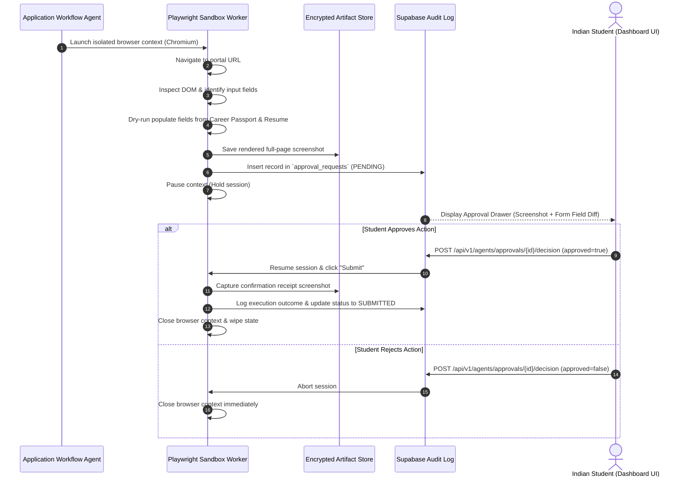

# Opportunity OS — Playwright Browser Execution & Human Approval Architecture

## 1. Safety Mandates & Ethical Boundaries

1. **Mandatory Human-in-the-Loop Gate:** The browser execution engine will **never** submit a form or commit an external action without explicit, cryptographic-timestamped user approval.
2. **Strict Anti-Bypass Policy:**
   - **Never** bypass, crack, or automate solving CAPTCHA, Cloudflare Turnstile, or anti-bot challenges. If a challenge appears, the automation halts and yields control to the student.
   - **Never** store user third-party credentials or passwords in plaintext.
   - **Never** violate portal Terms of Service. If a portal explicitly prohibits automated form filling, the system generates a filled PDF and pre-filled instructions for the student instead.

---

## 2. Browser Execution Lifecycle

---

## 3. Sandboxing & Isolation

- **Ephemeral Contexts:** Each execution runs in a brand new, isolated Playwright `BrowserContext`. No cookies, local storage, or browsing history persist after the session terminates.
- **Audit Logging:** Every DOM interaction, typed string, file upload, and navigation event is logged with microsecond timestamps in `browser_execution_logs`.
- **Duplicate Submission Guard:** The database enforces a unique constraint on `(user_id, opportunity_id)` in the `applications` table to prevent accidental double-submissions.
