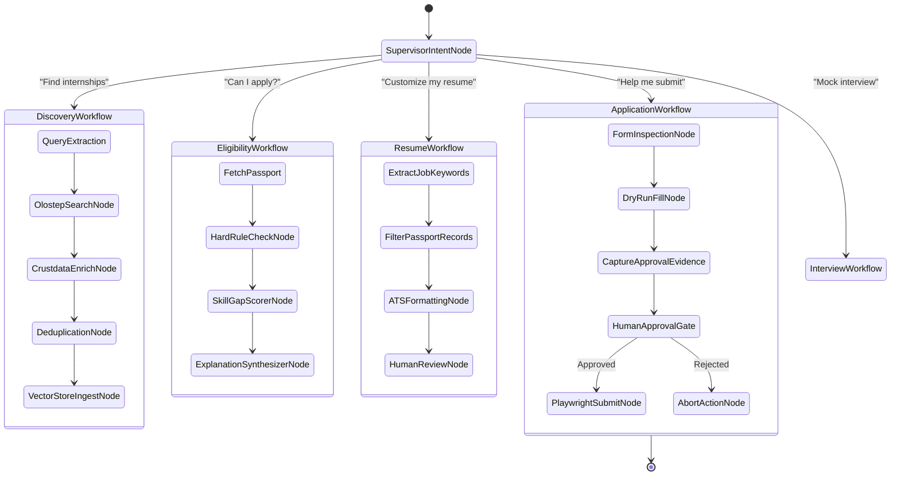

# Opportunity OS — LangGraph Agent Workflows & Tool Contracts

## 1. Core Principles & Safety Guardrails

1. **Zero Hallucination Guarantee:** Agents are strictly forbidden from inventing opportunities, application deadlines, stipends, or eligibility thresholds. All opportunity data must include a verified source URL and retrieval timestamp.
2. **Grounded Resume Synthesis:** Resumes can only be composed from the student's verified `Career Passport`. Agents cannot fabricate projects, scores, or degrees.
3. **Mandatory Human-in-the-Loop Gate:** Irreversible actions (especially web form submissions or email dispatches) require explicit user approval via the `ApprovalNode`.

---

## 2. Nine Controlled LangGraph Workflows



### 2.1 Career Guidance Workflow
- **State:** `user_id`, `conversation_history`, `career_goals`, `academic_profile`, `recommended_paths`.
- **Nodes:** `AnalyzeStrengthsNode` $\rightarrow$ `SkillDemandMatchNode` $\rightarrow$ `GuidanceSynthesizerNode`.
- **Tools:** `get_student_passport`, `query_market_trends`.

### 2.2 Opportunity Discovery Workflow
- **State:** `search_query`, `filters`, `raw_results`, `enriched_results`.
- **Nodes:** `QueryExpansionNode` $\rightarrow$ `OlostepScrapeNode` $\rightarrow$ `CrustdataFirmographicsNode` $\rightarrow$ `EmbeddingIndexNode`.
- **Tools:** `olostep_search`, `olostep_scrape`, `crustdata_company_enrich`.

### 2.3 Eligibility Analysis Workflow
- **State:** `student_id`, `opportunity_id`, `hard_pass`, `score`, `missing_skills`.
- **Nodes:** `DeterministicFilterNode` (branch, CGPA, graduation year) $\rightarrow$ `SemanticSkillMatcherNode` $\rightarrow$ `ExplanationFormatterNode`.

### 2.4 Resume Creation Workflow
- **State:** `student_id`, `target_role`, `generated_resume`.
- **Nodes:** `FetchPassportNode` $\rightarrow$ `SectionBuilderNode` $\rightarrow$ `ATSOptimizerNode`.

### 2.5 Resume Customization Workflow
- **State:** `master_resume_id`, `opportunity_id`, `tailored_sections`, `alignment_score`.
- **Nodes:** `JobDescriptionAnalyzerNode` $\rightarrow$ `PassportFactMatcherNode` $\rightarrow$ `BulletPointTailorerNode`.

### 2.6 Application Preparation Workflow
- **State:** `student_id`, `opportunity_id`, `form_schema`, `extracted_fields`.
- **Nodes:** `PortalScraperNode` $\rightarrow$ `FormMappingNode` $\rightarrow$ `ValidationNode`.

### 2.7 Application Submission Workflow (Strict Human-in-the-Loop)
- **State:** `application_id`, `form_data`, `screenshot_url`, `approval_id`, `submission_status`.
- **Nodes:** `DryRunFillNode` $\rightarrow$ `AwaitApprovalNode` (Halts execution and writes to DB) $\rightarrow$ `PlaywrightExecutionNode` $\rightarrow$ `ReceiptVerificationNode`.
- **Safety:** Halts until a webhook or API call confirms `status == 'approved'`.

### 2.8 Opportunity Monitoring Workflow
- **State:** `monitor_id`, `target_url`, `last_content_hash`, `new_opportunities_detected`.
- **Nodes:** `OlostepScheduleCheckNode` $\rightarrow$ `DiffDetectionNode` $\rightarrow$ `NotificationDispatchNode`.

### 2.9 Interview Preparation Workflow
- **State:** `opportunity_id`, `student_id`, `question_index`, `audio_buffer`, `feedback`.
- **Nodes:** `QuestionGenerationNode` $\rightarrow$ `AudioEvaluationNode` $\rightarrow$ `ScorecardSynthesisNode`.

---

## 3. Typed Tool Contracts (Pydantic)

```python
from pydantic import BaseModel, Field, HttpUrl
from typing import List, Optional

class OlostepSearchParams(BaseModel):
    query: str = Field(description="Semantic search query for internships/jobs in India")
    max_results: int = Field(default=10, le=50)

class CrustdataEnrichParams(BaseModel):
    company_domain: str = Field(description="Company domain name (e.g. razorpay.com)")

class PlaywrightDryRunParams(BaseModel):
    portal_url: HttpUrl
    student_profile_id: str
    resume_pdf_path: str
```
