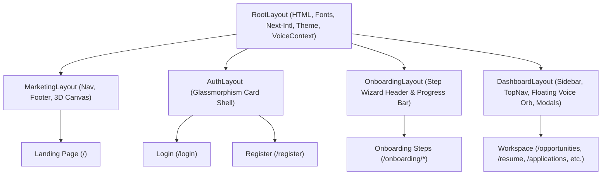

# Opportunity OS — Frontend Navigation & Layout Architecture

**Role & Standard:** Senior Frontend Architecture Specification  
**Designated Owner:** Sanju (Frontend & UX Lead)  
**Target Viewports:** 360px Compact Mobile, 415px Mobile, 768px Tablet, 1024px+ Desktop  

---

## 1. Global Layout Topology

Opportunity OS uses nested Next.js 15 App Router layouts to separate public marketing, authentication, onboarding, and authenticated workspace shells.



---

## 2. Authenticated Dashboard Layout Shell

### 2.1 Desktop Layout ($\ge 1024\text{px}$)
- **Left Sidebar (Fixed, 260px):**
  - Brand Logo & Version Pill (`Opportunity OS v0.1.0`).
  - Navigation Links with Lucide icons and active route indicators (`bg-indigo-500/10 text-indigo-400 border-r-2 border-indigo-500`).
  - Active Language Pill Indicator (`తెలుగు (te)` / `हिन्दी (hi)`).
  - Storage & Profile mini-badge.
- **Top Header (Fixed height, 64px, Sticky):**
  - Breadcrumbs navigation (`Workspace > Opportunities > AI Intern`).
  - Global Search Bar (`Cmd+K` keyboard shortcut trigger).
  - Language Quick-Switcher Dropdown.
  - Notification Bell with unread counter badge.
  - User Avatar & Profile Dropdown menu.
- **Main Content Area:** Scrollable viewport with `max-w-7xl mx-auto px-6 py-8`.
- **Persistent Voice Orb:** Anchored at bottom-right (`fixed bottom-8 right-8 z-50`).

### 2.2 Tablet Layout ($768\text{px} - 1023\text{px}$)
- **Collapsible Rail Sidebar (72px collapsed, 260px expanded on click/hover):**
  - Icons visible in rail mode with tooltip labels.
- **Top Header:** Retains search, notifications, and profile.
- **Voice Orb:** Repositioned to `fixed bottom-6 right-6 z-50`.

### 2.3 Mobile Layout ($360\text{px} - 767\text{px}$)
- **Top Mobile Header (56px):**
  - Hamburger Menu button (opens sliding sheet drawer).
  - Opportunity OS mini logo.
  - Notification icon.
- **Bottom Navigation Bar (Fixed, 60px):**
  - 4 Primary Tabs: `Overview`, `Opportunities`, `Passport`, `Applications`.
  - Center-docked Voice Trigger: Elevated circular button centered above bottom nav, ensuring one-thumb voice accessibility.
- **Full-Screen Slide Drawer:** Houses Secondary links (`Resume Studio`, `Interview Simulator`, `Analytics`, `Settings`, `Sign Out`).

---

## 3. Persistent Global Voice Orb Positioning & Non-Occlusion Guarantee

To ensure the persistent 3D Voice Orb never covers primary page controls (such as "Submit", "Apply", or pagination buttons):

1. **Dedicated Viewport Safe Zone:**
   - On desktop: Content containers maintain `pb-24` padding so bottom content scrolls above the Voice Orb.
   - On mobile: The Voice Orb is cleanly integrated into the center notch of the bottom navigation bar (`h-14 w-14 rounded-full -mt-6 bg-gradient-to-r from-indigo-600 to-cyan-500 shadow-xl border-4 border-[#090D16]`).
2. **Draggable & Dockable Option:** On desktop viewports, students can drag the Voice Orb along the right viewport margin if it obstructs specialized split-screen code or resume editors.
3. **Collision Avoidance:** Modals and approval drawers render at `z-[100]`, dimming the background and temporarily lowering the Voice Orb z-index to prevent touch interception during critical decision points.

---

## 4. Route Transitions & Breadcrumb Hierarchy

- **Page Transitions:** Managed via `Motion` (`framer-motion`) with a lightweight opacity fade ($150\text{ms}$) to prevent visual jarring while respecting `prefers-reduced-motion`.
- **Breadcrumb Hierarchy:**
  ```text
  Workspace
  └── Opportunities
      └── AI Research Intern — AI4Bharat
  ```
  Every breadcrumb segment is a clickable Next.js `<Link>` component with schema.org `BreadcrumbList` microdata.
