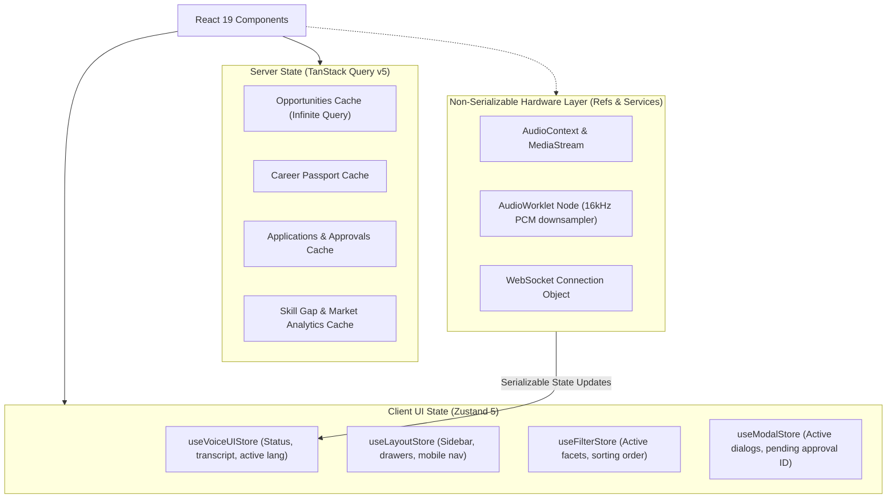

# Opportunity OS — Frontend State Management Architecture

**Role & Standard:** Senior Frontend Architecture Specification  
**Designated Owner:** Sanju (Frontend & UX Lead)  
**Standardized Core:** Zustand 5.0 (Client UI State) & TanStack Query v5 (Server State)

---

## 1. State Domain Separation & Architecture Boundary

Opportunity OS enforces a strict architectural partition between **Server Cache State** and **Client UI State**. Mixing server data into global client stores is strictly prohibited.



---

## 2. Server State Architecture: TanStack Query v5

We standardize on **TanStack Query v5** as our sole server state orchestrator. SWR is not used.

### 2.1 Standardized Query Key Factory
To prevent cache key collisions and enable surgical cache invalidation, all query keys are created via a centralized factory:

```typescript
// apps/web/src/lib/query-keys.ts
export const queryKeys = {
  auth: {
    me: ['auth', 'me'] as const,
  },
  opportunities: {
    all: ['opportunities'] as const,
    list: (filters: Record<string, unknown>) => ['opportunities', 'list', filters] as const,
    detail: (id: string) => ['opportunities', 'detail', id] as const,
    eligibility: (id: string) => ['opportunities', 'eligibility', id] as const,
  },
  passport: {
    all: ['passport'] as const,
    items: ['passport', 'items'] as const,
  },
  resumes: {
    all: ['resumes'] as const,
    detail: (id: string) => ['resumes', 'detail', id] as const,
  },
  applications: {
    all: ['applications'] as const,
    approvals: ['applications', 'approvals', 'pending'] as const,
  },
};
```

### 2.2 Cache Invalidation & Mutation Flow
- **Optimistic Updates on Bookmarking:** When a student saves an opportunity, the UI immediately flips the bookmark icon, updating the query cache optimistically. If the server request fails, the cache rolls back automatically with an error toast.
- **Approval Invalidation:** When an approval request is decided (`POST /agents/approvals/{id}/decision`), the mutation invalidates both `queryKeys.applications.approvals` and `queryKeys.applications.all`.

---

## 3. Client State Architecture: Zustand 5

Zustand stores are kept small, domain-specific, and atomic.

| Store Name | File Location | Responsibilities | Serializable? |
| :--- | :--- | :--- | :---: |
| `useVoiceUIStore` | `apps/web/src/store/voice-ui-store.ts` | Status (`idle`, `listening`, `speaking`, `error`), active language code, transcript text, error message | **Yes** |
| `useLayoutStore` | `apps/web/src/store/layout-store.ts` | Sidebar open/collapsed, mobile drawer, active tab | **Yes** |
| `useFilterStore` | `apps/web/src/store/filter-store.ts` | Role filters, location filters, remote toggle, min stipend | **Yes** |
| `useModalStore` | `apps/web/src/store/modal-store.ts` | Active modal ID (`approval_modal`, `resume_export_modal`) | **Yes** |

---

## 4. CRITICAL VOICE HARDWARE RULE: Non-Serializable Objects

> [!CAUTION]
> **NEVER store `AudioContext`, `MediaStream`, `AudioWorkletNode`, `WebSocket`, or `AudioBuffer` inside Zustand or Redux!**

### The Rule & Rationale
1. Non-serializable Web Audio objects break state rehydration, cause memory leaks, and trigger React rendering cycle bugs.
2. Hardware instances must be managed exclusively inside **Custom React Refs (`useRef`)** or a dedicated singleton **`AudioStreamingService`**.
3. The `AudioStreamingService` emits serializable metadata (`status: 'listening'`, `rmsVolume: 0.74`, `transcript: '...'`) into `useVoiceUIStore`.
