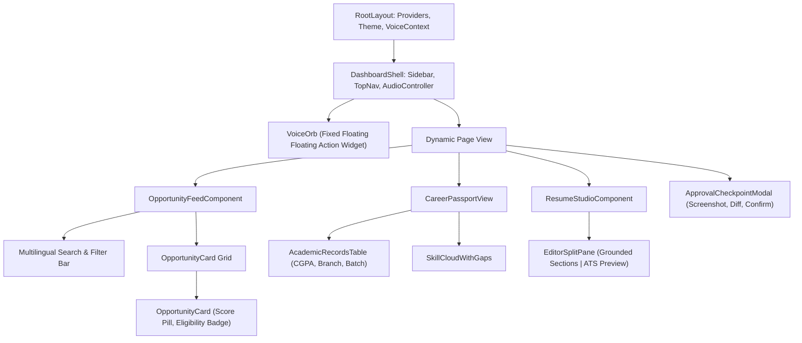

# Opportunity OS — Frontend Component Architecture Blueprint

## 1. Route Structure & App Router Layout

Opportunity OS uses Next.js 15+ App Router. Routes are categorized into marketing, authentication, core dashboard, and specialized feature workspaces.

```text
apps/web/src/app/
│
├── layout.tsx                     # Global Root Layout (Themes, Font, Analytics, Voice State)
├── page.tsx                       # High-impact Landing & Multilingual Hero
├── globals.css                    # Tailwind CSS 3.4 variables & design tokens
│
├── (auth)/                        # Authentication Route Group
│   ├── login/page.tsx             # Supabase Auth Login
│   └── register/page.tsx          # Student Onboarding & Language Selection
│
├── (dashboard)/                   # Authenticated Workspace Group
│   ├── layout.tsx                 # Dashboard Shell (Sidebar, Header, Floating Voice Orb)
│   ├── overview/page.tsx          # Student Snapshot, Matches, Application Funnel
│   │
│   ├── opportunities/             # Opportunity Intelligence Hub
│   │   ├── page.tsx               # Infinite Filterable Opportunity Feed
│   │   └── [id]/page.tsx          # Opportunity Deep-Dive, Eligibility Breakdown
│   │
│   ├── career-passport/           # Verified Student Profile
│   │   └── page.tsx               # Academic records, verified skills, badges
│   │
│   ├── resume/                    # ATS Resume Studio
│   │   ├── page.tsx               # Master Resume & Tailored Versions
│   │   └── editor/page.tsx        # Split-screen Markdown/LaTeX preview
│   │
│   ├── applications/              # Application Command Center
│   │   └── page.tsx               # Kanban board & Pending Approval Drawer
│   │
│   ├── interview/                 # Multilingual Interview Simulator
│   │   └── page.tsx               # Real-time voice interview room with Gemini Live
│   │
│   ├── analytics/                 # Market Intelligence & Skill Gap Trends
│   │   └── page.tsx               # Regional job demand & salary benchmarks
│   │
│   └── settings/                  # User Settings
│       └── page.tsx               # Language, Notification frequency, Privacy
```

---

## 2. Frontend Component Hierarchy



---

## 3. State Management Strategy

1. **Global Voice & Session State (`Zustand`):**
   - Active language (`en`, `hi`, `te`, `ta`, `kn`, `ml`, `bn`).
   - Voice Orb status (`idle`, `listening`, `processing`, `speaking`, `error`).
   - Web Audio streaming context and active WebSocket connection handle.
2. **Server State & Data Fetching (`TanStack Query / SWR Pattern`):**
   - Opportunity feed caching, cursor-based pagination, and optimistic updates for saved jobs.
   - Profile and Career Passport caching.
3. **Local Component State (`React 19 Hooks`):**
   - Form inputs, modal toggles, split-pane sliders.

---

## 4. Voice UI Architecture & Three.js Canvas

- **Voice Orb (`VoiceOrb.tsx`):** Built with React Three Fiber / WebGL shaders for fluid, responsive audio visualization.
  - When idle: Gentle cyan/indigo undulating sphere.
  - When listening: High-frequency acoustic waveform reaction to student's microphone input.
  - When speaking: Pulsing purple/glow shader synchronized with audio frequency bytes from Gemini Live.
- **Accessibility & Fallback:** Complete keyboard navigation (`Tab` + `Space` to talk) and automatic graceful degradation to text chat if Web Audio or WebSockets are unavailable.

---

## 5. Responsive Design & Loading / Error States

- **Mobile First:** Designed for 360px width upwards (reflecting real Indian college student smartphone usage).
- **Skeleton Screens:** Tailwind animated shimmer placeholders for opportunity cards and resume editors.
- **Error Boundaries:** Isolated per feature module to ensure an error in the 3D canvas or voice stream does not crash the entire dashboard.
