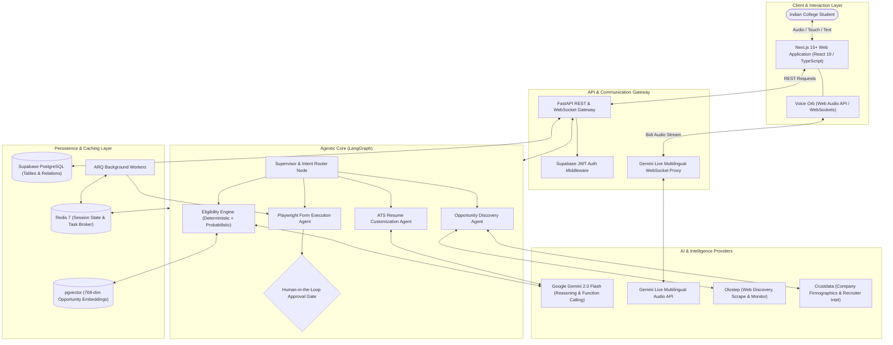
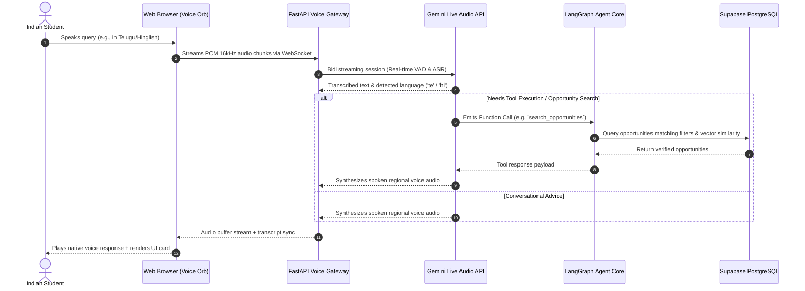
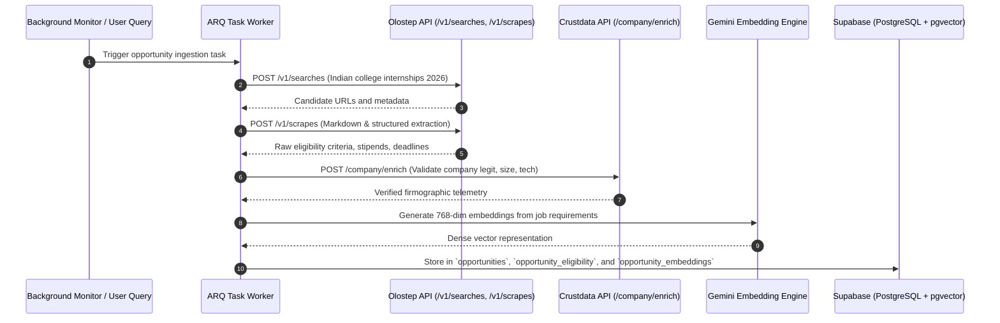
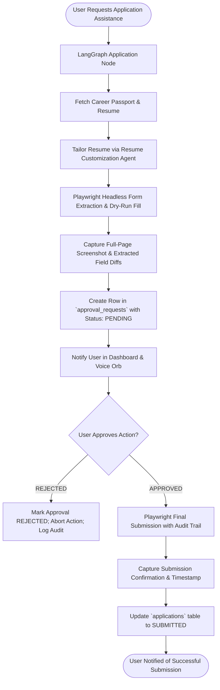

# Opportunity OS — System Architecture Blueprint

## 1. High-Level System Architecture

Opportunity OS is designed as an agentic, voice-first career intelligence operating system for Indian college students. The architecture decouples client presentation from agentic planning, deterministic verification, and asynchronous browser execution.

---

## 2. Voice Request Lifecycle

The platform prioritizes real-time, low-latency multilingual voice interaction across 7 Indian regional languages (Hindi, Telugu, Tamil, Kannada, Malayalam, Bengali, and English).

---

## 3. Opportunity Discovery & Ingestion Lifecycle

---

## 4. Application Execution Lifecycle & Approval Gate

Under no circumstances does an agent submit external applications without explicit user approval.

---

## 5. Data Flow and Trust Boundaries

| Zone | Boundary | Authentication & Validation |
| :--- | :--- | :--- |
| **Zone 1: Public Web / Client** | User Browser to Frontend | HTTPS / WSS, CSP, CORS headers, Content Sanitization |
| **Zone 2: Application Gateway** | Frontend to FastAPI Gateway | Supabase JWT Bearer Tokens, Rate Limiting (Redis-backed token bucket) |
| **Zone 3: Internal Agent Network** | FastAPI to LangGraph / Workers | In-memory / Private Redis network, strict Pydantic schema validation |
| **Zone 4: Data Layer** | Backend to PostgreSQL / pgvector | SSL required, Row Level Security (RLS) enforcement per user session |
| **Zone 5: External Providers** | Backend to Olostep / Crustdata / Gemini | Outbound HTTPS with secret API keys managed via environment variables |
| **Zone 6: Browser Sandbox** | Playwright Worker to Target Job Portals | Isolated ephemeral browser context; never bypasses CAPTCHA; Human approval mandatory |
