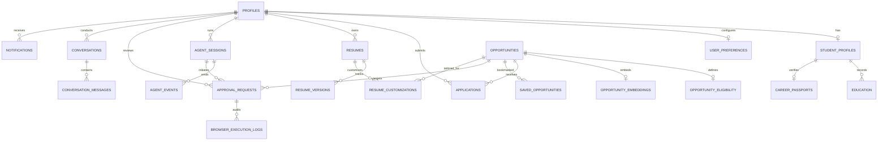

# Opportunity OS — Database Schema & Entity Relationships

## 1. Overview & Extensions

The database is built on **PostgreSQL 16** via **Supabase**, with the following extensions enabled:
- `uuid-ossp`: High-entropy UUID primary keys.
- `vector`: pgvector extension supporting vector similarity searches (cosine distance index with 768 dimensions for Gemini embeddings).

---

## 2. Entity-Relationship Diagram (ERD)

---

## 3. Detailed Table Specifications

### 3.1 Profiles & Identity
- **`public.profiles`**: Extends `auth.users` with user full name, avatar, email, and preferred regional language (`en`, `hi`, `te`, `ta`, `kn`, `ml`, `bn`). RLS ensures users only read and update their own records.
- **`public.student_profiles`**: Deep educational telemetry including college name, degree, branch/stream, graduation year, CGPA, and state of domicile.
- **`public.education`**: Granular school, diploma, and degree credentials with scores and graduation timelines.
- **`public.skills`**: Master taxonomy of technical, soft, and domain skills.
- **`public.user_preferences`**: Role filters, preferred work locations, remote-work affinity, minimum acceptable stipends, and alert frequencies.

### 3.2 Career Passport & Grounded Resumes
- **`public.career_passports`**: Verified single-source-of-truth document containing student coursework, certified projects, hackathon finishes, and badges. Serves as ground truth for resume generation to eliminate AI hallucinations.
- **`public.resumes`**: Master resume blueprints in structured JSON format.
- **`public.resume_versions`**: Immutable revision snapshots with associated compiled PDF artifact URLs.
- **`public.resume_customizations`**: Targeted variations tailored per specific `opportunity_id` with similarity alignment scores.

### 3.3 Opportunity Intelligence
- **`public.opportunities`**: Ingested internships, scholarships, and jobs with structured titles, organizations, locations, stipends, and source provenance.
- **`public.opportunity_sources`**: Ingestion source health, scraping frequencies, and data provider metadata (`olostep`, `crustdata`).
- **`public.opportunity_eligibility`**: Deterministic rule sets: allowable graduation batches, accepted degrees/branches, minimum CGPA thresholds, and mandatory skill prerequisites.
- **`public.opportunity_embeddings`**: 768-dimensional dense vectors indexed with IVFFlat for sub-millisecond semantic retrieval.
- **`public.saved_opportunities`**: Student bookmarks with personal notes.

### 3.4 Applications, Agents & Human Approval Gate
- **`public.applications`**: Application lifecycle tracking (`discovered` $\rightarrow$ `evaluating` $\rightarrow$ `drafting` $\rightarrow$ `ready_for_review` $\rightarrow$ `approved` $\rightarrow$ `submitted`).
- **`public.agent_sessions`**: Active LangGraph state machine executions.
- **`public.agent_events`**: Step-by-step audit events emitted by LangGraph nodes.
- **`public.approval_requests`**: **Critical Human-in-the-Loop Gate**. Records proposed actions (e.g. form submission), diffs, and waits for user decision (`pending`, `approved`, `rejected`).
- **`public.browser_execution_logs`**: Step-level Playwright execution logs with timestamps, actions taken, target selectors, and screenshot references.

### 3.5 Multilingual Conversations & Monitoring
- **`public.conversations` & `public.conversation_messages`**: Chat history with language tag attribution.
- **`public.voice_sessions`**: Telemetry on voice sessions, duration, detected languages, and transcription accuracy.
- **`public.opportunity_monitors`**: Scheduled background monitors watching target company portals.
- **`public.analytics_events`**: Telemetry for matching funnel conversion and skill gap trends.

---

## 4. Security, RLS & Privacy Rules

1. **Row Level Security (RLS):** Every user-owned table enforces `auth.uid() = user_id`.
2. **Credential Isolation:** Never store third-party portal passwords in database tables. Ephemeral browser automation uses session cookies stored in encrypted worker memory or user-directed manual login.
3. **Audit Immutability:** Execution logs and approval decisions are append-only.
