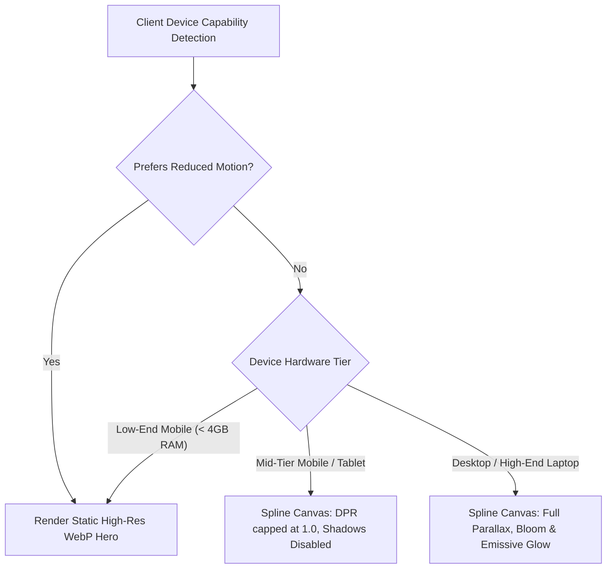

# Opportunity OS — 3D Hero Scene Performance & Production Plan

## 1. Technical Budget & Production Targets

The 3D hero scene must run smoothly on ordinary Indian student laptops (e.g. Intel Core i3 / i5 with integrated graphics) and mid-tier Android smartphones without draining battery or causing thermal throttling.

*Note: Values below represent Proposed Engineering Targets vs. Maximum Permissible Ceilings.*

| Metric | Target Budget | Hard Maximum Ceiling | Optimization Technique |
| :--- | :---: | :---: | :--- |
| **Polygon Count (Tris)** | $\le 45,000$ | $75,000$ | Low-poly hard-surface geometric modeling |
| **Draw Calls per Frame** | $\le 40$ | $80$ | Material batching; shared emissive shaders |
| **Compressed File Size** | $\le 3.5\text{ MB}$ | $5.0\text{ MB}$ | Spline LZMA/Brotli mesh compression |
| **Texture Atlas Resolution** | $1024 \times 1024$ | $2048 \times 2048$ | WebP/KTX2 texture compression |
| **First Contentful Paint (FCP)**| $< 1.2\text{ s}$ | $1.8\text{ s}$ | HTML & headline render before 3D canvas streams |
| **Time to Interactive (3D Scene)**| $< 2.8\text{ s}$ | $4.5\text{ s}$ | Asynchronous streaming via CDN |
| **Steady-State Frame Rate (FPS)** | $60\text{ FPS}$ | $\ge 30\text{ FPS}$ (Mobile) | Throttled RAF loop; adaptive pixel ratio ($1.0 - 1.5$) |
| **Idle GPU Utilization** | $< 15\%$ | $25\%$ | Pause animation loop when out-of-viewport |

---

## 2. Device Tier Adaptation Matrix



### 2.1 Low-Power Laptop & Mobile Constraints
- **Device Pixel Ratio (DPR) Clamping:** High-density Retina and OLED screens ($2\times$ or $3\times$ DPR) render up to 9 times as many pixels. The canvas clamps DPR to `1.0` on mobile and `1.5` on desktop:
  ```typescript
  renderer.setPixelRatio(Math.min(window.devicePixelRatio, 1.5));
  ```
- **Post-Processing Shaders:** Screen-space ambient occlusion (SSAO) and heavy depth-of-field shaders are disabled in favor of baked ambient occlusion in the building textures.
- **Touch Gesture Protection:** Mobile browsers lock horizontal and vertical touch drags on the 3D canvas so students can smoothly scroll down the page without getting "trapped" in the 3D orbit controls.

---

## 3. Asset Hosting & CDN Caching Strategy

1. **Global Edge Delivery:** The compiled `.splinecode` binary file is hosted on Spline's global Cloudflare CDN edge or self-hosted in `apps/web/public/models/hero-campus.splinecode`.
2. **HTTP Caching Headers:**
   ```http
   Cache-Control: public, max-age=31536000, immutable
   Content-Encoding: br
   ```
3. **Preload Link Header:** For high-speed desktop connections, a non-blocking `<link rel="preload" href="/models/hero-campus.splinecode" as="fetch" crossorigin="anonymous">` is injected in `layout.tsx`.

---

## 4. Failure Modes & Automated Recovery

| Failure Scenario | Detection Trigger | Recovery Mechanism |
| :--- | :--- | :--- |
| **WebGL Context Lost** | `webglcontextlost` event | Immediately swap canvas with `HeroSceneFallback` static WebP |
| **Asset Download Timeout** | Download exceeds 6 seconds | Abort fetch, render static fallback, log silent telemetry |
| **Low Frame Rate ($< 20\text{ FPS}$)**| RAF timer measures frame drops | Disable shadow maps and step down render resolution |
| **Reduced Motion Preference**| `prefers-reduced-motion: reduce` | Lock camera to neutral isometric angle; disable mouse parallax |
