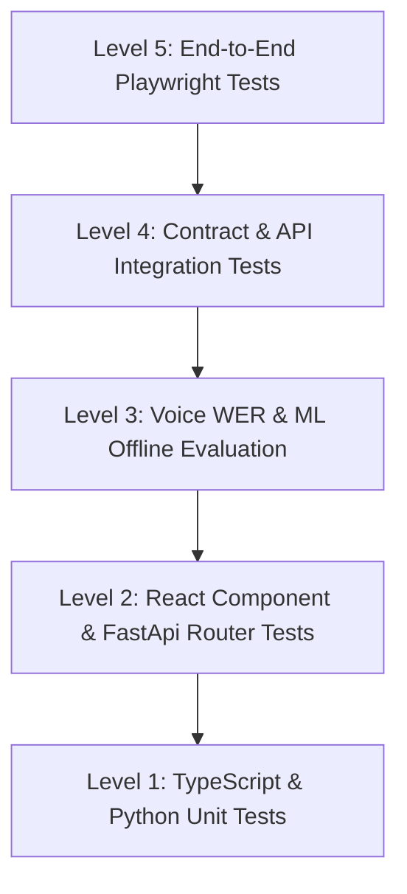

# Opportunity OS — Quality & Testing Architecture Strategy

## 1. Testing Philosophy & Quality Standard

Opportunity OS is a mission-critical platform where errors directly affect student career opportunities. Our quality philosophy enforces:
1. **Zero Hallucination Guardrails:** Automated validation ensures resumes and AI advice are 100% grounded in verified student records.
2. **Deterministic Hard Gates:** Hard eligibility constraints (graduation batch, degree, CGPA) are tested with property-based unit tests to guarantee 0% false positives.
3. **No Unapproved Submissions:** Browser automation workflows have dedicated assertion gates verifying execution pauses for student approval.
4. **Multilingual Robustness:** Spoken Indic voice interactions are evaluated for word error rate (WER) and code-switching resilience across all 7 supported languages.

---

## 2. Test Level Taxonomy & Tooling

| Test Level | Scope | Primary Framework | Execution Environment |
| :--- | :--- | :--- | :--- |
| **Level 1: Unit Tests** | Pure business logic, validators, DTO mappers | `pytest` (API) & Node Test Runner (Web) | Local / CI (< 15s) |
| **Level 2: Component Tests** | React components, UI states, Voice Orb shader | React Testing Library / Vitest | Local / CI (< 45s) |
| **Level 3: Integration Tests** | FastAPI routes, Supabase migrations, Redis tasks | `pytest` with `httpx` TestClient | Local Docker / CI (< 90s) |
| **Level 4: Contract Tests** | DTO parity between TS and Python schemas | Schema validation scripts | CI (< 30s) |
| **Level 5: E2E Browser Tests** | Student journey, form dry-run, approval modal | Playwright (Chromium) | Scheduled CI / Staging |
| **Specialized: Voice & WER** | Indic audio recognition & code-switching tests | Custom Python test harnesses | Offline / GPU Runner |
| **Specialized: ML Offline** | Embeddings, reranking, and skill gap models | Jupyter / PyTorch evaluation scripts | Offline (Sanju) |
| **Security & Privacy** | Secret scanning, dependency audits, RLS tests | Gitleaks, pip-audit, Supabase RLS test suite | Pre-commit / CI |
| **Accessibility (a11y)** | WCAG 2.1 AA compliance, keyboard navigation | Axe-core / `@axe-core/playwright` | CI E2E run |
| **Performance & Load** | WebSocket voice concurrency, P90 latency | Locust / k6 | Staging / Performance CI |

---

## 3. Risk-Based Testing Matrix

| Test ID | Test Scenario | Expected Result | Owner | Feasibility | Priority |
| :--- | :--- | :--- | :---: | :---: | :---: |
| **T-UNIT-01** | Deterministic batch verification (student 2024 vs job 2026) | Rejects application with deterministic reason | Ramaraju | Fully Automated | **P0** |
| **T-UNIT-02** | Zero-hallucination resume bullet validation | Rejects bullet point not mapped to Career Passport | Sanju | Fully Automated | **P0** |
| **T-UNIT-03** | Pydantic RFC 7807 error formatting on 422 errors | ProblemDetails JSON returned with invalid params | Ramaraju | Fully Automated | **P1** |
| **T-COMP-01** | VoiceOrb visual state changes (idle $\rightarrow$ listening $\rightarrow$ speaking) | Correct CSS/shader classes applied on props | Sanju | Fully Automated | **P1** |
| **T-COMP-02** | ApprovalCheckpointModal renders dry-run screenshot & diff | Screenshot visible; Approve/Reject buttons clickable | Sanju | Fully Automated | **P0** |
| **T-INT-01** | FastAPI `/health` endpoint under mock PostgreSQL/Redis | Returns `HTTP 200` with `status: healthy` | Ramaraju | Fully Automated | **P0** |
| **T-INT-02** | Olostep search provider adapter parses scraped markdown | Returns typed `OpportunityDTO` list | Ramaraju | Mocked in CI | **P1** |
| **T-INT-03** | Crustdata company enrichment entity resolution | Ambiguous name maps to canonical company record | Ramaraju | Mocked in CI | **P1** |
| **T-E2E-01** | Full dry-run application execution flow | Playwright halts at approval gate; does not submit | Ramaraju | Fully Automated | **P0** |
| **T-E2E-02** | User approves dry-run form | Playwright resumes and records submission receipt | Ramaraju | Fully Automated | **P0** |
| **T-VOICE-01**| WebSocket `/voice/stream` duplex audio latency | First spoken audio byte returned in $< 650\text{ms}$ | Sanju / Ramaraju | Automated Harness | **P0** |
| **T-VOICE-02**| Code-mixed Hindi-English ("Hinglish") voice query | Correct intent and regional voice response | Sanju | Semi-Automated | **P1** |
| **T-VOICE-03**| Telugu audio recognition with background hostel noise | WER $< 12\%$ under SNR 15dB | Sanju | Semi-Automated | **P2** |
| **T-ML-01** | pgvector cosine similarity ranking for SDE roles | Relevant opportunities in top 10 (Recall@10 $> 85\%$) | Sanju | Automated Script | **P1** |
| **T-SEC-01** | RLS policy prevents Student A from reading Student B resume | Supabase returns 403 / empty result | Ramaraju | Fully Automated | **P0** |
| **T-SEC-02** | Secret scanner detects committed API keys or JWT secrets | Gitleaks fails CI build if secret committed | Antigravity | Fully Automated | **P0** |
| **T-A11Y-01**| Keyboard-only navigation across Opportunity Feed | Full tab stop navigation without focus traps | Sanju | Automated (Axe) | **P1** |
| **T-PERF-01**| 50 concurrent voice WebSocket streams | P95 latency remains under $800\text{ms}$; 0 dropped streams | Shared | Locust Load Test | **P2** |
| **T-REC-01** | Network disconnection during Playwright dry-run | State saved in `browser_execution_logs`; no crash | Ramaraju | Automated Fault Test | **P1** |

---

## 4. Failure Recovery & Fault Injection Strategy

1. **Voice Streaming Disconnect:** If the client WebSocket drops, the client automatically degrades to text mode while preserving the conversational history.
2. **Third-Party Provider Outage (Olostep/Crustdata):** If Olostep or Crustdata APIs return 5xx or rate-limit (429), the system serves cached listings from PostgreSQL and marks source status as `degraded` without blocking user search.
3. **Target Portal Anti-Bot Defense:** If an employer portal presents an unexpected Cloudflare challenge or CAPTCHA during Playwright dry-run, the agent immediately stops, marks the execution status as `requires_manual_completion`, and presents instructions for the student to complete directly.
