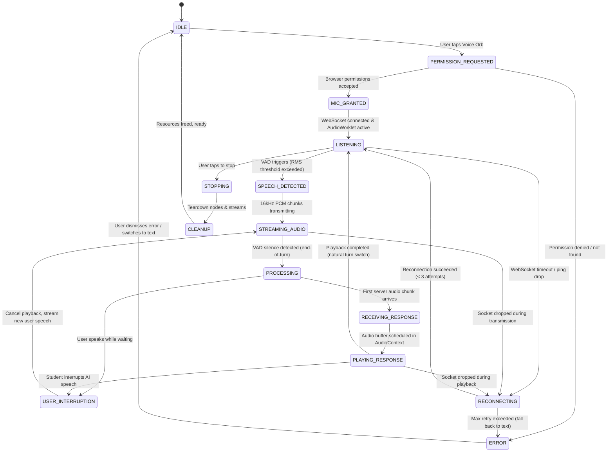

# Opportunity OS — Voice Orb & Web Audio Frontend Architecture Specification

**Document Version:** 1.0.0  
**Phase:** Homingo Phase 5 — Engineering Blueprint  
**Subsystem:** Voice Frontend & Web Audio Architecture  
**Owner:** Sanju (Frontend & ML Lead)  
**Supporting Architect:** Antigravity (Architecture QA)  
**Implementation Target:** `apps/web/src/components/voice/` & `apps/web/src/services/audio/`  

---

## 1. Executive Summary & Design Principles

Opportunity OS is fundamentally a **voice-first** intelligence platform. For Indian college students who may be hesitant in English or navigating complex career platforms for the first time, voice interaction is their primary, lowest-friction gateway to opportunity discovery, eligibility clarity, resume tailoring, and interview practice.

To deliver an exceptional user experience on modern mobile and desktop browsers across India's diverse cellular networks (4G/5G/Broadband), the voice frontend must satisfy four strict operational invariants:

1. **Sub-600ms Conversational Latency:** From the moment a student finishes speaking, audio processing and initial response streaming must occur with perceivable immediacy ($< 600\text{ms}$ time-to-first-audio-byte).
2. **Deterministic State Governance (14 Distinct States):** Voice hardware, network sockets, and rendering lifecycles must never enter desynchronized or zombie states.
3. **Strict Separation of Audio Hardware from React State:** Browser audio objects (`AudioContext`, `MediaStream`, `AudioWorkletNode`, and `WebSocket`) **MUST NEVER** be placed inside React state or Zustand stores. They are encapsulated strictly inside a non-reactive service layer (`AudioStreamingService`) managed via React refs or singleton lifecycle hooks.
4. **Natural Full-Duplex Interruption & Graceful Fallback:** Students can interrupt AI speech at any moment; if network degradation or hardware permission failures occur, the UI immediately degrades to text chat without losing conversational context.

---

## 2. The 14-State Voice Lifecycle State Machine

The voice subsystem transitions through a finite set of 14 states. Transitions are strictly validated to prevent illegal operations (e.g., streaming audio before mic permission is granted).



### 2.1 State Matrix & Operational Semantics

| State ID | Enum Name | UI Voice Orb Visual State | Hardware / Network Activity | Transition Trigger |
| :--- | :--- | :--- | :--- | :--- |
| `01` | `IDLE` | Static glowing orb (cyan/navy pulse, slow 3s oscillation) | AudioContext suspended, mic closed, WS disconnected | Student taps Voice Orb or presses `Space` (with focus) |
| `02` | `PERMISSION_REQUESTED` | Spinning amber dashed ring | `navigator.mediaDevices.getUserMedia()` called | System prompt response (Allow / Deny) |
| `03` | `MIC_GRANTED` | Quick green flash, expanding ring | `MediaStream` acquired, sample rate identified | Automatic transition to connect WS |
| `04` | `LISTENING` | Active cyan breathing ring, low-amplitude wave | Mic stream connected to `AudioWorklet`, WS connected | VAD detects speech or User taps Stop |
| `05` | `SPEECH_DETECTED` | High-energy pulsing cyan core, waveform active | AudioWorklet captures user speech; local RMS $> -42\text{dB}$ | Sustained speech frames ready to stream |
| `06` | `STREAMING_AUDIO` | Dynamic waveform reacting to microphone input frequency | 16kHz linear PCM chunks sent over WS binary frames | VAD silence duration $> 650\text{ms}$ |
| `07` | `PROCESSING` | Indigo circulating orbital rings (AI thinking) | Audio streaming stopped, waiting for Gemini turn | Server sends first audio byte or tool event |
| `08` | `RECEIVING_RESPONSE` | Expanding violet waves, buffering incoming audio | Incoming PCM decoded into Web Audio playback buffers | First 100ms chunk ready to play |
| `09` | `PLAYING_RESPONSE` | Energetic violet/purple concentric ripple synced to TTS | AudioBufferSourceNodes scheduled sequentially | All chunks played OR student interrupts |
| `10` | `USER_INTERRUPTION` | Immediate red/cyan clash burst, instant mute | Current buffer source cancelled (`stop()`), WS `interrupted` packet sent | Student speech detected during AI playback |
| `11` | `RECONNECTING` | Flashing yellow badge with countdown | Backoff timer active; attempting WS reconnect | Reconnected OR Max retry (3) reached |
| `12` | `ERROR` | Red outlined ring with alert tooltip | Hardware released, error code stored, text fallback offered | User clicks retry or dismiss |
| `13` | `STOPPING` | Fading out rings, collapsing inwards | Stopping audio capture, sending end packet | Teardown initiated |
| `14` | `CLEANUP` | Resetting to zero state | Worklet terminated, tracks stopped, context closed | Return to `IDLE` |

---

## 3. Web Audio Architecture & Stream Pipeline

### 3.1 Audio Hardware & Capture Pipeline

Browser audio input natively samples at hardware rates (typically 44.1kHz or 48kHz). However, Gemini Live and low-latency multilingual ASR models require **16,000 Hz, 16-bit linear PCM, mono channel**.

To achieve this without blocking the React main UI thread, audio processing is delegated to an **AudioWorklet**.

```mermaid
flowchart LR
    Mic[Microphone Hardware] -->|48kHz Float32| MS[MediaStream]
    MS -->|Input Node| MSNode[MediaStreamAudioSourceNode]
    
    subgraph AudioThread["Dedicated Web Audio Thread"]
        MSNode --> Worklet[DownsampleAudioWorkletNode]
        Worklet -->|1. Polyphase Resampler: 48kHz -> 16kHz| Resample[Resample & Int16 Quantize]
        Resample -->|2. Fast RMS VAD| VAD[Voice Activity Detection]
    end
    
    Worklet -->|PostMessage Int16Array| AudioService[AudioStreamingService (Main Thread)]
    AudioService -->|Binary WS Frame (100ms)| WSClient[WebSocket Proxy]
    WSClient -->|WSS Stream| BackendAPI[FastAPI / Gemini Live Engine]
```

### 3.2 Output Playback & Jitter Buffer

Incoming synthesized regional audio arrives as streamed chunks of 16kHz/24kHz PCM from the backend over the WebSocket.

1. **Jitter Queue:** Chunks are placed in a sorted playback FIFO queue.
2. **Gapless Web Audio Scheduling:** The `AudioStreamingService` tracks `nextPlaybackTime`:
   $$\text{nextPlaybackTime} = \max(\text{audioCtx.currentTime}, \text{lastScheduledEndTime})$$
3. **Fast Interruption Flushing:** When `USER_INTERRUPTION` is triggered:
   - All currently active `AudioBufferSourceNode` instances are immediately stopped via `.stop(0)`.
   - The pending jitter queue is emptied.
   - `lastScheduledEndTime` is reset to `0`.
   - An `{ event: "interrupted", timestamp: Date.now() }` frame is dispatched upstream to halt Gemini Live generation.

---

## 4. Hardware Encapsulation & React Boundary

### 4.1 The Strict Boundary Rule

```
+--------------------------------------------------------------------------+
| REACT COMPONENT TREE & ZUSTAND STORE (apps/web)                          |
| Only stores:                                                             |
| - voiceState: VoiceLifecycleState (Enum)                                 |
| - currentLanguage: IndianLanguageCode ('en' | 'hi' | 'te' ...)            |
| - inputVolume: number (0.0 to 1.0, throttled 60fps for visualizer)       |
| - outputVolume: number (0.0 to 1.0 for visualizer)                       |
| - activeTranscript: { user: string; agent: string }                      |
| - lastErrorMessage: string | null                                        |
+--------------------------------------------------------------------------+
                                    |
                    Method Invocations & Event Callbacks
                                    |
                                    v
+--------------------------------------------------------------------------+
| NON-REACTIVE AUDIO SERVICE LAYER (apps/web/src/services/audio/)          |
| AudioStreamingService (Encapsulated Class Instance / Ref)                 |
| - window.AudioContext                                                    |
| - MediaStream (Microphone input tracks)                                  |
| - AudioWorkletNode (Downsampler & PCM converter)                         |
| - AnalyserNode (FFT frequency & time-domain data)                        |
| - WebSocket connection (`/api/v1/voice/stream`)                          |
| - ArrayBuffer queues and Web Audio Source Nodes                          |
+--------------------------------------------------------------------------+
```

### 4.2 Zustand Voice State Store Schema

```typescript
// apps/web/src/stores/useVoiceOrbStore.ts
import { create } from 'zustand';

export type VoiceLifecycleState =
  | 'IDLE'
  | 'PERMISSION_REQUESTED'
  | 'MIC_GRANTED'
  | 'LISTENING'
  | 'SPEECH_DETECTED'
  | 'STREAMING_AUDIO'
  | 'PROCESSING'
  | 'RECEIVING_RESPONSE'
  | 'PLAYING_RESPONSE'
  | 'USER_INTERRUPTION'
  | 'RECONNECTING'
  | 'ERROR'
  | 'STOPPING'
  | 'CLEANUP';

export type IndianLanguage = 'en' | 'hi' | 'te' | 'ta' | 'kn' | 'ml' | 'bn';

interface VoiceOrbState {
  lifecycleState: VoiceLifecycleState;
  selectedLanguage: IndianLanguage;
  inputVolume: number;
  outputVolume: number;
  liveTranscript: {
    user: string;
    agent: string;
  };
  errorMessage: string | null;
  retryCount: number;
  isTextFallbackActive: boolean;

  // Actions
  setLifecycleState: (state: VoiceLifecycleState) => void;
  setLanguage: (lang: IndianLanguage) => void;
  setVolumes: (inputVol: number, outputVol: number) => void;
  updateTranscript: (userText?: string, agentText?: string) => void;
  clearTranscript: () => void;
  setError: (msg: string | null) => void;
  incrementRetry: () => void;
  resetVoiceState: () => void;
  toggleTextFallback: (active?: boolean) => void;
}

export const useVoiceOrbStore = create<VoiceOrbState>((set) => ({
  lifecycleState: 'IDLE',
  selectedLanguage: 'en',
  inputVolume: 0,
  outputVolume: 0,
  liveTranscript: { user: '', agent: '' },
  errorMessage: null,
  retryCount: 0,
  isTextFallbackActive: false,

  setLifecycleState: (lifecycleState) => set({ lifecycleState }),
  setLanguage: (selectedLanguage) => set({ selectedLanguage }),
  setVolumes: (inputVolume, outputVolume) => set({ inputVolume, outputVolume }),
  updateTranscript: (user, agent) =>
    set((state) => ({
      liveTranscript: {
        user: user !== undefined ? user : state.liveTranscript.user,
        agent: agent !== undefined ? agent : state.liveTranscript.agent,
      },
    })),
  clearTranscript: () => set({ liveTranscript: { user: '', agent: '' } }),
  setError: (errorMessage) => set({ errorMessage }),
  incrementRetry: () => set((state) => ({ retryCount: state.retryCount + 1 })),
  resetVoiceState: () =>
    set({
      lifecycleState: 'IDLE',
      inputVolume: 0,
      outputVolume: 0,
      errorMessage: null,
      retryCount: 0,
    }),
  toggleTextFallback: (active) =>
    set((state) => ({
      isTextFallbackActive: active !== undefined ? active : !state.isTextFallbackActive,
    })),
}));
```

---

## 5. WebSocket Communication Protocol (`/api/v1/voice/stream`)

All voice streaming sessions communicate with the backend proxy via a secure WebSocket connection. The handshake requires the student's JWT token for authentication.

### 5.1 Protocol Handshake

- **Endpoint:** `wss://api.opportunityos.in/api/v1/voice/stream`
- **Subprotocol / Query:** `wss://api.opportunityos.in/api/v1/voice/stream?token=<SUPABASE_JWT>`
- **Frame Types:**
  - **Text frames:** JSON envelopes for state events, control signals, and transcripts.
  - **Binary frames:** Raw linear Int16 PCM audio buffers (16,000 Hz, mono).

### 5.2 JSON Envelope Specification

```typescript
// Client to Server: Initial Session Handshake
export interface VoiceSessionInitPayload {
  event: 'session_init';
  language: IndianLanguage; // 'en' | 'hi' | 'te' | 'ta' | 'kn' | 'ml' | 'bn'
  sampleRate: 16000;
  clientTimestamp: number;
}

// Client to Server: User Interruption Signal
export interface VoiceInterruptionPayload {
  event: 'interrupted';
  timestamp: number;
}

// Server to Client: Real-Time ASR Transcript
export interface VoiceTranscriptPayload {
  event: 'transcript';
  speaker: 'user' | 'agent';
  isFinal: boolean;
  text: string;
  detectedLanguage?: IndianLanguage;
  confidence?: number;
}

// Server to Client: Agent Tool Execution Notification
export interface VoiceToolStartPayload {
  event: 'tool_start';
  toolName: 'search_opportunities' | 'evaluate_eligibility' | 'tailor_resume';
  displayName: string; // e.g. "Searching 2026 tech internships..."
}

// Server to Client: Error Signal
export interface VoiceErrorPayload {
  event: 'error';
  code: 'AUDIO_DEVICE_ERROR' | 'RATE_LIMIT_EXCEEDED' | 'GEMINI_TIMEOUT' | 'UNAUTHENTICATED';
  message: string;
  canRetry: boolean;
}
```

---

## 6. Mobile Browser Audio Policies & Hardware Resilience

### 6.1 Autoplay & User Gesture Requirement
Modern mobile browsers (iOS Safari and Android Chrome) block `AudioContext` activation until an explicit user interaction (touch or click) occurs.

- **Implementation:** The `AudioStreamingService.start()` function is triggered strictly in the `onClick` / `onTouchEnd` handler of the Voice Orb component.
- If `audioContext.state === 'suspended'`, the service invokes `await audioContext.resume()` immediately before requesting `getUserMedia()`.

### 6.2 Acoustic Echo Cancellation (AEC)
To ensure the student's microphone does not capture the AI's spoken voice from the phone speakers, `getUserMedia` constraints are strictly declared:

```typescript
const AUDIO_CONSTRAINTS: MediaStreamConstraints = {
  audio: {
    channelCount: 1,
    sampleRate: 16000,
    echoCancellation: true,
    noiseSuppression: true,
    autoGainControl: true,
  },
  video: false,
};
```

### 6.3 Audio Device Failure & Network Degradation Recovery

1. **Permission Denied / No Hardware Found:**
   - State immediately transitions to `ERROR`.
   - UI displays a clear modal explaining how to enable microphone permissions in browser settings.
   - One-click button: *"Continue in Text Mode"* seamlessly switches to standard chat input without reload.
2. **WebSocket Disconnection during Turn:**
   - State switches to `RECONNECTING`.
   - Audio input capture pauses.
   - Exponential backoff retry occurs at $1\text{s}$, $2\text{s}$, and $4\text{s}$ (max 3 retries).
   - If reconnect succeeds, pending context is preserved. If it fails, state transitions to `ERROR` with automatic text fallback.

---

## 7. Voice Orb Visualizer & Canvas Animation

The Voice Orb component (`apps/web/src/components/voice/VoiceOrb.tsx`) visualizes voice activity using an HTML5 Canvas and Web Audio `AnalyserNode`.

### 7.1 Visual States & Particle Simulation
- **FFT Analyser Configuration:** `fftSize: 256`, `smoothingTimeConstant: 0.8`.
- In `LISTENING` and `STREAMING_AUDIO`: Particle radii and glow intensities modulate directly with the student's voice RMS and frequency bins.
- In `PROCESSING`: Particles converge into a revolving double-ring helix (Indigo `#4F46E5`).
- In `PLAYING_RESPONSE`: Particles expand outward in harmonic waves (Cyan `#06B6D4` and Violet `#8B5CF6`).
- **Reduced Motion Support:** When `prefers-reduced-motion: reduce` is detected, 60fps canvas particle physics are replaced by smooth CSS opacity transitions and a clean static status ring.
