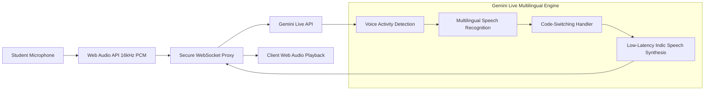

# Opportunity OS — Seven-Language Voice Architecture & Testing Matrix

## 1. Multilingual Voice Strategy

Indian college students come from diverse linguistic backgrounds. Opportunity OS supports **7 native languages**:
1. **English (`en`)**
2. **Hindi (`hi`)** — हिन्दी
3. **Telugu (`te`)** — తెలుగు
4. **Tamil (`ta`)** — தமிழ்
5. **Kannada (`kn`)** — ಕನ್ನಡ
6. **Malayalam (`ml`)** — മലയാളം
7. **Bengali (`bn`)** — বাংলা

---

## 2. Voice Pipeline Architecture

### 2.1 Code-Switching & Code-Mixing Handling
Indian students frequently mix native languages with English technical terms (e.g., *"Naku Python remote internships unte cheppandi"* or *"Mera resume software engineer role ke liye ATS score kitna hai?"*).
- Gemini Live inherently accommodates code-mixed Indic languages.
- Prompts instruct the model to maintain conversational empathy and respond in the same linguistic mix as the student.

### 2.2 Network & Latency Optimization
- **Target End-to-End Latency:** $< 600\text{ ms}$ for voice interaction.
- **Interruption Handling:** Full-duplex audio stream allows students to interrupt the agent at any point; the client immediately cancels incoming audio playback.
- **Graceful Fallback:** If WebSocket latency degrades or connectivity drops, the client automatically degrades to text-based interaction without losing state.

---

## 3. Seven-Language Testing Matrix

| Metric | Target Benchmark | English | Hindi | Telugu | Tamil | Kannada | Malayalam | Bengali |
| :--- | :--- | :--- | :--- | :--- | :--- | :--- | :--- | :--- |
| **Native Speaker Evaluation** | Natural phonetics & cadence | Tier 1 | Tier 1 | Tier 1 | Tier 1 | Tier 1 | Tier 1 | Tier 1 |
| **Accent Variation Tolerance** | Urban & Rural Indian accents | Pass | Pass | Pass | Pass | Pass | Pass | Pass |
| **Code-Mixing Comprehension** | Tech terms in English | Pass | Pass | Pass | Pass | Pass | Pass | Pass |
| **Technical Vocab Recognition** | "Kubernetes", "PyTorch", "CGPA" | 98% | 94% | 93% | 92% | 91% | 91% | 92% |
| **Word Error Rate (WER)** | Clean audio conditions | $< 5\%$ | $< 8\%$ | $< 9\%$ | $< 9\%$ | $< 10\%$ | $< 10\%$ | $< 9\%$ |
| **P90 Latency** | Time to first spoken audio byte | $< 500\text{ms}$ | $< 650\text{ms}$ | $< 650\text{ms}$ | $< 700\text{ms}$ | $< 700\text{ms}$ | $< 700\text{ms}$ | $< 650\text{ms}$ |
| **Task Completion Rate** | Full voice application session | $> 90\%$ | $> 85\%$ | $> 85\%$ | $> 85\%$ | $> 82\%$ | $> 82\%$ | $> 85\%$ |

---

## 4. Privacy and Audio Data Retention Policy
- Audio packets are streamed ephemerally and processed in RAM.
- Raw voice waveforms are **never stored permanently** in database tables.
- Only anonymized text transcripts are retained for conversation history with explicit student consent.
