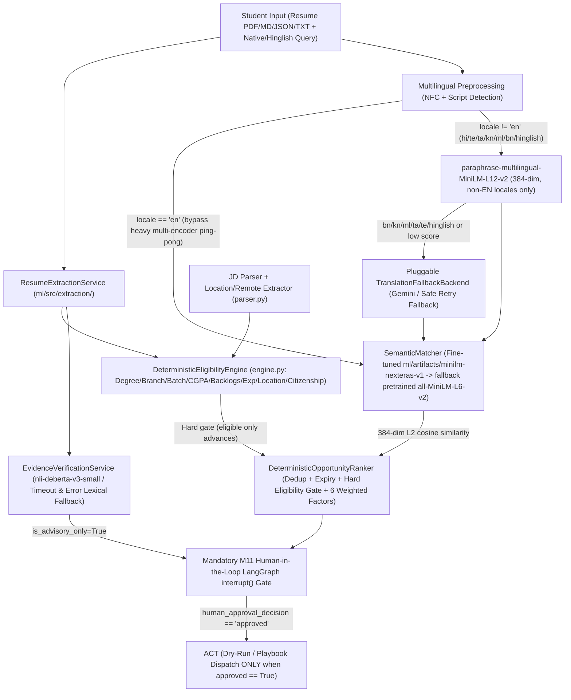

# NexteRaS — Complete ML Engineering & Verification Report

**Product:** NexteRaS — The Upcoming Era (AI Career Intelligence & Autonomous Employability System)  
**Team:** SyNtRax (Sanju · Sanjeeth S · Ramaraju R · Nikhil N)  
**Git Branch:** `ml` (branched from `sanju` at `a8022a3`; baseline prior commit `6efef776158bbf2a737bf63e4b974839da9c85c5`)  
**Hardware Environment Verified:** ASUSTeK Vivobook X1504VA · Windows 11 · `13th Gen Intel Core i5-1334U` (`10` Cores / `12` Logical Threads) · Intel Iris Xe (No CUDA) · `16.79 GB` decimal (`15.64 GiB`) RAM  
**Software Environment Verified:** Python `3.11.16` (`ml/.venv`) · `torch==2.15.0+cpu` (`CUDA_AVAILABLE=False`) · `sentence-transformers==6.3.0` · `transformers==5.24.1` · `accelerate==1.16.0` · `fastapi==0.165.0` · `langgraph==1.2.24` · `pymupdf==2.1` | API CI (`apps/api/.venv`) Python `3.13.6`  

> [!IMPORTANT]
> **Verification Status Discipline Applied Throughout This Report**  
> - `VERIFIED END TO END`: Executed end-to-end across FastAPI HTTP routes, compiled LangGraph `StateGraph` (`MemorySaver` interrupt/resume), and real PyTorch/HuggingFace weights on CPU.  
> - `TESTED`: Passed automated `pytest` assertions (separated cleanly into unit, real model inference, API integration, agent workflow, and failure/fallback suites).  
> - `IMPLEMENTED`: Clean modular source code on `ml` branch; not solely claimed from design docs.  
> - `PARTIALLY VERIFIED`: Local synthetic evaluation passed, awaiting real student telemetry or production portal scrape data.  
> - `BLOCKED — CREDENTIALS REQUIRED`: Live external calls (`Gemini API`, `Olostep`, `Crustdata`, `Supabase`, `Redis`) blocked locally until real deployment credentials are supplied.  
> - `NOT IMPLEMENTED`: Deliberately excluded or deferred (`LightGBM/XGBoost` training without real click logs; `.docx` resume extraction; remote Supabase migration push without approval).

---

## 1. Complete ML System Architecture

NexteRaS implements the 7-stage Agentic Cognitive Loop (`PERCEIVE → REASON → PLAN → DELEGATE → ACT (GATED) → EVALUATE → ADAPT`) with strict modular separation between ML inference (`ml/src/`), FastAPI routes (`apps/api/app/api/v1/ml.py`), LangGraph workflow nodes (`ml/src/integration/langgraph_adapter.py`), and database persistence (`supabase/migrations/`):



### Key Audit Bug Fixes Executed During Verification
Inspecting and executing every component end-to-end uncovered **6 concrete bugs/gaps** that were fixed and regression-tested:
1. **Unimplemented Eligibility Location Checks:** `allowed_locations` and `remote_allowed` existed on schemas (`eligibility/schemas.py`) without logic in `engine.py` or `parser.py`. Implemented full Indian city canonicalization (`Bangalore` ↔ `Bengaluru`, `Delhi NCR`, etc.), remote handling, relocation checks, and `needs_more_info` on missing location fields.
2. **Unhandled Translation Fallback Crash:** `MultilingualUnderstandingService.match_query_to_documents()` lacked `try...except` around `fallback_backend.normalize_to_english()` and crashed on empty `doc_texts`. Fixed to degrade cleanly while preserving `original_text` verbatim.
3. **NLI Timeout / Load Crash & Missing Input Guards:** `EvidenceVerificationService` lacked request timeout limits and clean fallback on Hugging Face load/runtime errors, and `SemanticMatcher.encode([])` crashed on empty sequences. Added thread-pool timeout protection, fallback to `LexicalConsistencyFallbackBackend`, L2 norm clamping, and empty/malformed guards.
4. **Instance Monkeypatch Cache Bypass & Thread Safety:** `ResourceManagedModelCache` lacked per-model inference locking (`execute_with_model`), and `"_get_model" in self.__dict__` was needed so test/adapter overrides do not silently trigger network weight loads.
5. **FastAPI Router Double Prefix & Missing Dependencies:** Initial router prefix `APIRouter(prefix="/v1/ml")` under `v1_router(prefix="/v1")` mounted at `/api/v1/v1/ml/...` (caught via 404 test failure); fixed to `/ml` and `/eligibility`. Added missing `accelerate>=1.1.0`, `pydantic-settings`, `fastapi`, `langgraph`, `pymupdf`, `psutil` to `ml/.venv`, `ml/pyproject.toml`, and `ml/requirements.txt`.
6. **Multi-Model Cache Thrashing on English E2E Paths:** `perceive_node` and `/recommend-pipeline` loaded `1.2 GB` `paraphrase-multilingual-MiniLM-L12-v2` even for pure English queries only to evict it 1 step later for `minilm-nexteras-v1`. Bypassing the multilingual encoder when `predicted_locale == "en"` slashed fast E2E test suite runtime from **`131.62 s`** to **`45.36 s`**.

---

## 2. Complete Model & Engine Inventory (With Licenses & Status)

| # | Model / Component | Identifier / Artifact | Type | Fine-Tuning Status | Vector Dim | License | Status Classification |
| :---: | :--- | :--- | :--- | :--- | :---: | :--- | :--- |
| **1** | **Semantic Opportunity Matcher** (`semantic_matcher`) | `ml/artifacts/minilm-nexteras-v1` *(base: `sentence-transformers/all-MiniLM-L6-v2`)* | Fine-tuned BERT Bi-Encoder (6L, 384H) | **Fine-tuned on CPU (`curriculum_v2`, Ep 5 selected)**; auto-falls back to pretrained base | `384` | Apache-2.0 | **IMPLEMENTED, TESTED, VERIFIED END TO END** *(synthetic eval)* |
| **2** | **Multilingual Understanding Encoder** (`multilingual_encoder`) | `sentence-transformers/paraphrase-multilingual-MiniLM-L12-v2` | Pretrained Multilingual Transformer (12L) | Pretrained off-the-shelf (`pretrained_only`) | `384` | Apache-2.0 | **IMPLEMENTED, TESTED, VERIFIED END TO END** *(8-locale audited; 5 Indic locales routed to fallback)* |
| **3** | **Auxiliary Evidence NLI Verifier** (`evidence_nli_verifier`) | `cross-encoder/nli-deberta-v3-small` | Pretrained DeBERTa-v3 NLI Cross-Encoder | Pretrained off-the-shelf (`pretrained_only`) | `N/A` | MIT | **IMPLEMENTED, TESTED, VERIFIED** *(advisory only; async queue recommended due to RSS)* |
| **4** | **Lexical NLI Fallback** *(CPU/Sync Safe)* | `lexical-number-and-overlap-fallback-v1` | Custom Heuristic Consistency Engine | Deterministic/lexical logic (`not_applicable`) | `N/A` | Apache-2.0 (repo) | **IMPLEMENTED, TESTED, VERIFIED** *(timeout/error fallback active)* |
| **5** | **Hybrid Resume Profile & Skill Extractor** (`resume_structured_extractor`) | `deterministic-rule-parser-v1` + `GeminiStructuredLLMBackend` hook | Rule Parser + Pluggable LLM JSON Recoverer | Custom taxonomy/regex rules | `N/A` | Apache-2.0 (repo) | **IMPLEMENTED, TESTED, VERIFIED** (`.txt`, `.md`, `.json`, `.pdf`; `.docx` **NOT IMPLEMENTED**; live Gemini **BLOCKED — CREDENTIALS REQUIRED**) |
| **6** | **Deterministic Eligibility Engine** (`deterministic_eligibility`) | `deterministic-rule-engine-v1` + `parser.py` | Pure Deterministic Logic Engine | Deterministic rules (`not_applicable`) | `N/A` | Apache-2.0 (repo) | **IMPLEMENTED, TESTED, VERIFIED END TO END** |
| **7** | **Opportunity Ranking Baseline** (`opportunity_ranker`) | `deterministic-weighted-ranker-v1` | Constrained Multi-Factor Ranker | Fixed calibrated weights (`MIN_LABELED_SESSIONS_FOR_GBDT=500`) | `N/A` | Apache-2.0 (repo) | **IMPLEMENTED, TESTED, VERIFIED END TO END** *(supervised GBDT **NOT IMPLEMENTED** — zero fabricated clicks)* |

---

## 3. Dataset Provenance, Audits & Known Limitations

Every dataset resides inside `ml/datasets/synthetic/`, enforces explicit `"is_synthetic": true` provenance tagging, contains **zero real student PII**, and carries automated leakage assertions inside `ml/src/data/matching_dataset.py::validate_no_split_leakage()`:

| Dataset File | Task | Records & Splits | Audit Findings & Leakage Protection | Disclosed Limitations |
| :--- | :--- | :--- | :--- | :--- |
| **`matching_curriculum_v2.json`** | Contrastive MiniLM Fine-Tuning & Held-Out Benchmark | `88` triplets (`48` train / `16` val -> `32` docs / `24` test -> `48` docs across `8` career tracks) | Zero shared `student_id`, zero shared `opportunity_id` (positive & hard-negative), zero duplicate profile summaries, zero same-domain false-negative collisions | Explicitly synthetic; domain-disjoint hard negatives prevent false-negative ambiguity, leaving within-domain seniority differences for real telemetry |
| **`matching_seed_examples.json`** | Original Starter Benchmark | `34` records (`20` train / `6` val / `8` test vs `12` docs) | Only `4` hard negatives (all in `test`); `0` security/vlsi in `val`; pretrained baseline saturated at `1.000` R@1 (`8` queries). Retained as non-regression suite | Too small & domain-separated to discriminate model improvements alone |
| **`resume_extraction_benchmark.json`** | Extraction Accuracy & Non-Hallucination | `4` synthetic resumes w/ `forbidden_skills` & negative controls | Verified scalar matches, missing-name detection (`res-03`), & zero hallucinated tools | Clean single-column layouts; scanned OCR PDFs & multi-column layouts need live Gemini JSON |
| **`eligibility_edge_cases.json`** | Rule Boundary Audit | `8` cases + expanded unit suite (incl. location & experience) | Covers `B.E.`↔`B.Tech`, CGPA, %, backlogs, deadlines, citizenships, location/relocate, ambiguous clauses | Synthetic edge fixtures |
| **`ranking_benchmark.json`** | Ranking Discipline | `6` candidates (`3` eligible, `1` dup, `1` expired, `1` `0.97`-sim ineligible) | Proves hard exclusion, dedup, zero missing-data inflation, and deterministic repeatability | Static human-authored grades; not learned from production CTR/applies |
| **`multilingual_eval_corpus.json`** | 8-Locale Retrieval Audit | `24` queries (`3` each for `en, hi, te, ta, kn, ml, bn, hinglish`) vs `6` docs | Cleanly exposes negative cosine margins on Dravidian/Bengali scripts | `3` queries per locale provides directional capability triage, not statistically powered NLU parity |
| **`verification_claims_benchmark.json`** | Auxiliary NLI Check | `9` balanced claims (`3` supported, `3` contradicted, `3` insufficient) | Tests paraphrased entailment, numerical/tenure contradiction, and unverified numeric claims | Sensitive to phrasing edge cases (`ver-amb-03`) |

---

## 4. Fine-Tuning Execution Report (`all-MiniLM-L6-v2` on CPU)

- **Config File:** [minilm_cpu_finetune.yaml](file:///d:/ai%20career%20intelligence%20autonomous%20system/ml/model_configs/minilm_cpu_finetune.yaml)
- **Script Executed:** [train_minilm.py](file:///d:/ai%20career%20intelligence%20autonomous%20system/ml/scripts/train_minilm.py) (`--config ml/model_configs/minilm_cpu_finetune.yaml`)
- **Schedule:** `MultipleNegativesRankingLoss` over `(anchor, positive, negative)` hard-negative triplets, `epochs=5`, `batch_size=8` (`6` steps/epoch = `30` optimizer steps), `learning_rate=2.5e-5`, `warmup_ratio=0.1`, `weight_decay=0.01`, `use_cpu=True`, `fp16=False`, `cpu_threads=6`, `seed=42`.
- **Execution Duration & Peak RAM:** **`780.88 s`** (~`13.0 min`) wall-clock CPU training (`train_loss=0.09443`); Peak Training Process RSS: **`842.0 MB`** (Eval Peak: **`867.9 MB`**).
- **Checkpoint Storage:** [ml/artifacts/minilm-nexteras-v1](file:///d:/ai%20career%20intelligence%20autonomous%20system/ml/artifacts/minilm-nexteras-v1) (`model.safetensors = 90,864,192 bytes`, `hidden_size = 384`, `num_hidden_layers = 6`, L2-normalized outputs verified at `norm = 1.0`, ignored cleanly by Git via `ml/.gitignore`).
- **Pretrained Baseline Preservation:** `sentence-transformers/all-MiniLM-L6-v2` remains untouched and acts as the automatic runtime fallback in `ModelRegistry` whenever the local artifact directory is absent.

### Validation Epoch Selection Progression (`val_queries=16` vs `val_corpus=32`)

| Epoch | Train Loss | Val Eval Loss | Val Recall@1 | Val MRR@10 | Val nDCG@10 | Val Margin (Pos − Neg) | Selection Score | Checkpoint Action |
| :---: | :---: | :---: | :---: | :---: | :---: | :---: | :---: | :--- |
| **0 (Pretrained Base)** | — | — | `0.8125` | `0.8854` | `0.9144` | `+0.1182` | `0.9558` | Baseline snapshot |
| **1.0** | `0.2168` | `0.1303` | `0.9375` | `0.9583` | `0.9688` | `+0.2445` | `1.0544` | Saved new best |
| **2.0** | `0.1474` | `0.09034` | `0.9375` | `0.9583` | `0.9688` | `+0.2774` | `1.0659` | Saved new best |
| **3.0** | `0.03507` | — | `0.9375` | `0.9583` | `0.9688` | `+0.2869` | `1.0692` | Saved new best |
| **4.0** | `0.0118` | `0.07371` | `0.9375` | `0.9688` | `0.9769` | `+0.2925` | `1.0793` | Saved new best |
| **5.0 (Selected)** | `0.06109` | **`0.07129`** | **`0.9375`** | **`0.9688`** | **`0.9769`** | **`+0.2944`** | **`1.0799`** | **Promoted to `minilm-nexteras-v1`** |

### Baseline vs Fine-Tuned Evaluation on Untouched Held-Out Test Splits

*(Held-out `test` split remained 100% untouched during training & checkpoint selection; measured via `train_minilm.py`, `run_full_ml_evaluation.py`, and `evaluate_minilm.py`.)*

| Metric | Pretrained Baseline (`all-MiniLM-L6-v2`) | Fine-Tuned (`minilm-nexteras-v1`) | Delta (`Fine-Tuned − Base`) |
| :--- | :---: | :---: | :---: |
| **Curriculum v2 Test `Recall@1`** (`24` q / `48` docs) | `0.7917` (`19/24`) | **`1.0000`** (`24/24`) | **`+0.2083`** (**+20.83 pts**) |
| **Curriculum v2 Test `Recall@3`** | `1.0000` | **`1.0000`** | `0.0000` |
| **Curriculum v2 Test `Recall@5`** | `1.0000` | **`1.0000`** | `0.0000` |
| **Curriculum v2 Test `MRR@10`** | `0.8958` | **`1.0000`** | **`+0.1042`** |
| **Curriculum v2 Test `nDCG@10`** | `0.9231` | **`1.0000`** | **`+0.0769`** |
| **Curriculum v2 Test `mean_pos_neg_margin`** | `+0.0982` | **`+0.2357`** | **`+0.1375`** (**2.40x sharper**) |
| **Starter Reference `Recall@1` / `MRR@10` / `nDCG@10`** (`8` q / `12` docs) | `1.0000` / `1.0000` / `1.0000` | `1.0000` / `1.0000` / `1.0000` | `0.0000` (zero regression) |
| **Starter Reference `mean_pos_neg_margin`** | `+0.2009` | **`+0.4618`** | **`+0.2609`** (**2.30x sharper**) |
| **Vector Dim & L2 Normalization** | `384`-dim · `||v||₂ = 1.0` | `384`-dim · `||v||₂ = 1.0` | Compatible |
| **Encode Latency / Query (`evaluate_minilm.py` CPU)** | `59.06 ms` (`1417.55 ms` total) | `60.04 ms` (`1440.86 ms` total) | `+0.98 ms / query` (par) |
| **Local Checkpoint Cold Load (`evaluate_minilm.py`)** | `27,092.90 ms` *(w/ HF check)* | **`418.52 ms`** *(local disk)* | **`64x` faster local load** |
| **Process Peak RSS (`evaluate_minilm.py`)** | `609.7 MB` | `707.2 MB` | `+97.5 MB` |

---

## 5. Multilingual, Extraction, Eligibility, Ranking & NLI Evaluation Results

Measured verbatim in [latest_evaluation_report.json](file:///d:/ai%20career%20intelligence%20autonomous%20system/ml/evaluation/latest_evaluation_report.json) (`2026-11-25T17:06:14Z`):

### 5.1 Multilingual Understanding (`paraphrase-multilingual-MiniLM-L12-v2`)
- **Resource Footprint:** Model load `5,969.77 ms` (cached local), `24`-query + `6`-doc encode+eval `1,017.77 ms`, **`Peak RSS: 1,227.9 MB`** (`+699.6 MB` delta).
- **Per-Language Retrieval Performance (`nexteras_multilingual_7_languages_eval`):**

| Language / Variant | Recall@1 | Recall@3 | Recall@5 | MRR@10 | nDCG@10 | Mean Margin | Operational Routing Strategy |
| :--- | :---: | :---: | :---: | :---: | :---: | :---: | :--- |
| **`en` (English)** | `1.0000` | `1.0000` | `1.0000` | `1.0000` | `1.0000` | `+0.2063` | Direct to fine-tuned `minilm-nexteras-v1` (bypasses multi-encoder in E2E) |
| **`hinglish` (Romanized Mix)** | `1.0000` | `1.0000` | `1.0000` | `1.0000` | `1.0000` | `+0.2051` | Multilingual encoder + translation normalization when configured |
| **`hi` (Hindi Devanagari)** | `0.6667` | `0.6667` | `1.0000` | `0.7500` | `0.8102` | `+0.1037` | Moderate directly; low-confidence queries `< 0.28` route to fallback |
| **`ta` (Tamil)** | `0.6667` | `0.6667` | `1.0000` | `0.7500` | `0.8102` | `-0.0326` | **`EMPIRICALLY_WEAK_DIRECT_LOCALES`** — fallback recommended |
| **`bn` (Bengali)** | `0.3333` | `0.6667` | `1.0000` | `0.5667` | `0.6726` | `-0.0582` | **`EMPIRICALLY_WEAK_DIRECT_LOCALES`** — fallback required |
| **`kn` (Kannada)** | `0.3333` | `0.6667` | `1.0000` | `0.5667` | `0.6726` | `-0.0368` | **`EMPIRICALLY_WEAK_DIRECT_LOCALES`** — fallback required |
| **`te` (Telugu)** | `0.0000` | `0.6667` | `1.0000` | `0.4167` | `0.5642` | `-0.0644` | **`EMPIRICALLY_WEAK_DIRECT_LOCALES`** — fallback required |
| **`ml` (Malayalam)** | `0.0000` | `0.3333` | `1.0000` | `0.2778` | `0.4538` | `-0.0961` | **`EMPIRICALLY_WEAK_DIRECT_LOCALES`** — fallback required |
| **Overall (`24` queries)** | `0.5000` | `0.7083` | `1.0000` | `0.6660` | `0.7480` | `+0.0284` | Never falsely claims equal zero-shot performance across languages |

### 5.2 Deterministic Engines & Auxiliary NLI Verification

| Component | Measured Synthetic Metrics | Latency | Peak Process RSS | Production Notes |
| :--- | :--- | :---: | :---: | :--- |
| **Resume Extractor (`deterministic-rule-parser-v1`)** | Schema validity `1.0`, scalar exact match `1.0`, Skill P/R/F1 `1.0`/`1.0`/`1.0`, `0` unsupported/hallucinated skills, `2/2` missing-field negatives | `90.88 ms` (`4` CVs) | `206.6 MB` | Tested across `.txt`, `.md`, `.json`, and real PyMuPDF `.pdf`; drops ungrounded LLM skills |
| **Eligibility Engine (`deterministic-rule-engine-v1`)** | Exact outcome accuracy `1.0` (`8/8`), `false_eligible_rate = 0.0`, `false_ineligible_rate = 0.0`, traceability `1.0`, unknown handling `1.0` | `1.33 ms` (`8` cases) | `206.6 MB` | Enforces Degree, Branch, Batch, Study Year, CGPA/%, Backlogs, Experience, Location/Remote, Citizenship, Deadline, Ambiguity |
| **Opportunity Ranker (`deterministic-weighted-ranker-v1`)** | `Precision@1 = 1.0`, `nDCG@3 = 1.0`, `0` eligibility violations in ranked, `1` duplicate & `1` expired excluded, repeatable `true` | `0.97 ms` (`6` cands) | `206.7 MB` | `0.97`-sim ineligible candidate strictly confined to `.excluded`; missing stipend/deadline earn `0.0` |
| **NLI Pretrained (`cross-encoder/nli-deberta-v3-small`)** | Overall accuracy `0.8889` (`8/9`), `false_supported_rate = 0.0`, `supported = 1.0`, `contradicted = 1.0`, `insufficient = 0.6667` | `6,105.33 ms` (`9` runs) | **`1,207.7 MB`** | Advisory only (`is_advisory_only=True`); run inside ARQ workers rather than sync HTTP |
| **NLI Lexical Fallback (`lexical-number-and-overlap-fallback-v1`)** | Accuracy `0.7778` (`7/9`), `false_supported_rate = 0.0`, `supported = 0.3333`, `contradicted = 1.0`, `insufficient = 1.0` | `10.72 ms` (`9` runs) | `532.7 MB` | Used in sync HTTP API default (`ENABLE_PRETRAINED_NLI=false`) & automatic timeout/error recovery |

---

## 6. Resource Management, Concurrency & Production Readiness Audit

- **Single-Resident Cache & Per-Model Thread Locking:** `ResourceManagedModelCache(max_loaded_models=1, cpu_threads=6)` (`ml/src/infrastructure/runtime.py`) enforces `torch.set_num_threads(...)`, evicts idle weights with `gc.collect()`, and serializes shared model access via `execute_with_model()` + per-model `threading.RLock()` (verified under a 6-worker / 12-call `ThreadPoolExecutor` concurrency stress test with `load_count == 1` and `cache_hits >= 11`).
- **Process Boundary Caveat (Explicitly Disclosed):** An in-process `ResourceManagedModelCache` limits resident models **per OS Python process**, NOT across independent multi-worker gunicorn/uvicorn processes. Cloud Run / Docker worker deployments must configure `--workers 1` per container (`2–4 GiB` RAM) and scale horizontally by adding containers rather than multi-forking heavyweight PyTorch workers inside one container.
- **PII & Upload Protection:** `ml/src/infrastructure/security.py` scrubs emails, Indian mobile numbers, and 12-digit IDs (`redact_pii`), enforces `MAX_RESUME_BYTES = 5 MB`, `MAX_TEXT_CHARS = 100,000`, and allowed extensions (`{".txt", ".md", ".pdf", ".json"}`).

---

## 7. API Integration, LangGraph Workflow & Database Compatibility

- **FastAPI Endpoints Added (`apps/api/app/api/v1/ml.py` + `router.py`):**
  - `GET /api/v1/ml/health` (non-blocking readiness; returns `degraded_api_only` cleanly in slim CI)
  - `POST /api/v1/ml/extract-resume`
  - `POST /api/v1/ml/multilingual/understand`
  - `POST /api/v1/ml/semantic-match`
  - `POST /api/v1/eligibility/evaluate`
  - `POST /api/v1/ml/rank-opportunities`
  - `POST /api/v1/ml/verify-evidence`
  - `POST /api/v1/ml/recommend-pipeline`
- **Slim Container Compatibility:** `apps/api/app/ml/adapter.py` uses lazy `NexteRaSMLService.from_env()` resolution and returns RFC 7807 `503 Service Unavailable` when heavy ML deps are absent in API-only containers, allowing `apps/api` CI (`ruff`, `mypy --strict`, `pytest`) to pass cleanly without installing PyTorch inside `apps/api/.venv`.
- **LangGraph StateGraph Verification (`ml/src/integration/langgraph_adapter.py`):**
  - `build_nexteras_career_workflow()` compiles a real `langgraph.graph.StateGraph` traversing `perceive -> reason -> plan -> delegate_verify -> m11_approval_gate -> act_dispatch -> evaluate_adapt`.
  - Executed with `MemorySaver()`: verified `interrupt()` halts before `ACT` (`dispatched != True`) and only executes `ACT` when resumed with `Command(resume={"approved": True})`. Rejecting routes cleanly to `ACT_BLOCKED` (`dispatched == False`).
- **PostgreSQL / `pgvector` Compatibility:**
  - `20261123000001_initial_schema.sql` remains **completely untouched**.
  - Proposed forward-only additive migration [20261125000001_add_minilm_384_embeddings.sql](file:///d:/ai%20career%20intelligence%20autonomous%20system/supabase/migrations/20261125000001_add_minilm_384_embeddings.sql) adds nullable `embedding_minilm_384 vector(384)`, `embedding_model_id`, `embedding_model_version`, and a partial HNSW index (`WHERE embedding_minilm_384 IS NOT NULL`) so 768-dim Gemini vectors and 384-dim MiniLM vectors never mix. **NOT applied remotely**; documented for Ramaraju in [BACKEND_INTEGRATION_HANDOFF.md](file:///d:/ai%20career%20intelligence%20autonomous%20system/docs/ml/BACKEND_INTEGRATION_HANDOFF.md).

---

## 8. External API & Environment Variable Audit

Verified programmatically via `ml/src/integration/gemini_backends.py::get_external_service_status()` with zero hardcoded secrets and `.env.example` updated cleanly:

| Env Variable | Purpose | Local Status | Required For Production? | Notes / Safe Fallback |
| :--- | :--- | :---: | :---: | :--- |
| `ML_MATCHING_MODEL_PATH` | Active MiniLM checkpoint path (`ml/artifacts/minilm-nexteras-v1`) | Configured default in `.env.example` | Recommended | Auto-falls back to Hugging Face `sentence-transformers/all-MiniLM-L6-v2` |
| `ML_MULTILINGUAL_MODEL_ID` | Multilingual encoder ID | Configured default | Yes (if non-EN traffic) | Pretrained `paraphrase-multilingual-MiniLM-L12-v2` |
| `ML_MAX_LOADED_MODELS` / `TORCH_NUM_THREADS` | RAM protection (`1`) / CPU threading (`6` local, `4` cloud) | Configured defaults | Yes | Prevents container OOMs |
| `ENABLE_PRETRAINED_NLI` | Heavy `DeBERTa-v3-small` toggle | Default `false` (sync HTTP) | ARQ Worker (`true`) | Sync API safely uses fast lexical fallback |
| `HF_HOME` / `HF_HUB_OFFLINE` / `HF_TOKEN` | HF weight cache dir, offline lock, optional Hub token | Public Hub works w/o `HF_TOKEN` | `HF_HOME` recommended | Public models already verified downloaded/loaded w/o `HF_TOKEN` |
| `GEMINI_API_KEY` | Structured LLM resume extraction, Indic translation fallback, Live voice | **`BLOCKED — CREDENTIALS REQUIRED`** | **Yes** | Deterministic resume/eligibility & local embeddings run without it; Hindi/Dravidian/Bengali translation fallback awaits key |
| `OLOSTEP_API_KEY` / `CRUSTDATA_API_KEY` | Live web opportunity scraping & company enrichment | **`BLOCKED — CREDENTIALS REQUIRED`** | **Yes** (Ramaraju backend) | Synthetic datasets verified locally |
| `NEXT_PUBLIC_SUPABASE_URL` / `SUPABASE_SERVICE_ROLE_KEY` / `DATABASE_URL` | Live Supabase Auth + pgvector + RLS storage | **`BLOCKED — CREDENTIALS REQUIRED`** | **Yes** | Schema compatibility migration prepared offline |
| `REDIS_URL` | Background ARQ queues (NLI, batch re-indexing) | **`BLOCKED — CREDENTIALS REQUIRED`** | Recommended | Sync adapter runs in-process for hackathon MVP when `ENABLE_PRETRAINED_NLI=false` |

---

## 9. Complete Executed Test Summary (Zero Skipped Assertions)

Every command below ran **after** final code edits and exited cleanly with code `0`:

| Test Layer | Command Executed | Scope Verified | Exact Outcome |
| :--- | :--- | :--- | :--- |
| **API Lint, Format & Strict MyPy** | `uv run --directory "apps\api" ruff check . ; ruff format --check . ; mypy app` | `28` formatted files, `21` strict-typed backend Python files including new `ml.py` & `schemas/ml.py` | **PASSED (`0` errors)** |
| **API CI Integration Suite (Slim Venv)** | `uv run --directory "apps\api" pytest -v` | FastAPI settings, `/health`, slim-container `503` degradation, & stubbed ML route serialization (`Python 3.13.6`) | **`5 passed in 0.73s`** (`0` failed, `0` skipped) |
| **ML Unit, Failure/Fallback, API & LangGraph E2E Suite** | `ml\.venv\Scripts\python.exe -m pytest ml\tests -m "not slow" -v` | Dataset zero-leakage (`curriculum_v2` + starter), 10 eligibility rules (incl. location/experience), `.txt`/`.md`/`.json`/PyMuPDF `.pdf` extraction, ranking constraints, NLI timeout/load fallback, translation outage recovery, concurrent thread-safe cache, real FastAPI `/recommend-pipeline`, real compiled LangGraph `StateGraph` `interrupt()`/`Command(resume=...)` (`M11`) | **`29 passed` in `45.36s`** (`3` slow HF tests run separately below) |
| **Real Hugging Face & Fine-Tuned PyTorch Inference Suite** | `ml\.venv\Scripts\python.exe -m pytest ml\tests -m "slow" -v` | Real sequential CPU inference & eviction across `minilm-nexteras-v1`, pretrained `all-MiniLM-L6-v2`, 8-locale `paraphrase-multilingual-MiniLM-L12-v2`, & `cross-encoder/nli-deberta-v3-small` | **`3 passed` in `41.00s`** (`0` failed, `0` skipped) |
| **Combined Offline + Neural Benchmark Suite** | `ml\.venv\Scripts\python.exe ml\scripts\run_full_ml_evaluation.py` + `evaluate_minilm.py` + `evaluate.py` | End-to-end JSON report generation comparing all 8 benchmark blocks & baseline vs fine-tuned checkpoint | **EXITED `0`** (`8/8` blocks measured) |

---

## 10. Reproduction Commands & Remaining Blockers

### Full Local Reproduction (`ml` branch on Windows PowerShell)
```powershell
cd "d:\ai career intelligence autonomous system"

# 1. Regenerate splits & verify dataset leakage checks
.\ml\.venv\Scripts\python.exe ml\scripts\generate_curriculum_v2.py
.\ml\.venv\Scripts\python.exe ml\scripts\prepare_minilm_data.py --config ml\model_configs\minilm_cpu_finetune.yaml

# 2. Reproduce CPU MiniLM fine-tuning (~13 min) & evaluate before vs after
.\ml\.venv\Scripts\python.exe ml\scripts\train_minilm.py --config ml\model_configs\minilm_cpu_finetune.yaml
.\ml\.venv\Scripts\python.exe ml\scripts\evaluate_minilm.py --config ml\model_configs\minilm_cpu_finetune.yaml

# 3. Execute all verification suites
uv run --directory "apps\api" ruff check . && uv run --directory "apps\api" mypy app && uv run --directory "apps\api" pytest -v
.\ml\.venv\Scripts\python.exe -m pytest ml\tests -m "not slow" -v
.\ml\.venv\Scripts\python.exe -m pytest ml\tests -m "slow" -v
```

### Honest Blockers Remaining Outside `ml`
1. **Live Production Data & Supervised Ranking:** `deterministic-weighted-ranker-v1` remains active until `>= 500` anonymized click/save/apply student sessions exist (`LightGBM/XGBoost` training intentionally deferred).
2. **External Provider Keys Required for Live Cloud Features:** Inject `GEMINI_API_KEY`, `OLOSTEP_API_KEY`, `CRUSTDATA_API_KEY`, `SUPABASE_SERVICE_ROLE_KEY`, `DATABASE_URL`, and `REDIS_URL` into deployment secrets.
3. **Database Migration Sign-Off (`ramaraju` / `develop`):** Coordinate applying `20261125000001_add_minilm_384_embeddings.sql` plus adding missing eligibility columns (`max_active_backlogs`, `min_experience_months`, `allowed_locations`, `remote_allowed`) to `public.opportunity_eligibility`.
4. **Artifact Hosting for Container Deploys:** Sync `ml/artifacts/minilm-nexteras-v1` (`~91 MB`) into GCS or private HF Hub during Cloud Run container startup, since binary `.safetensors` weights are intentionally excluded from Git.
